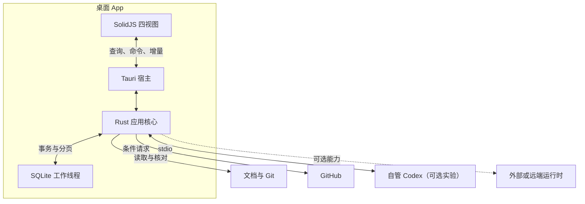
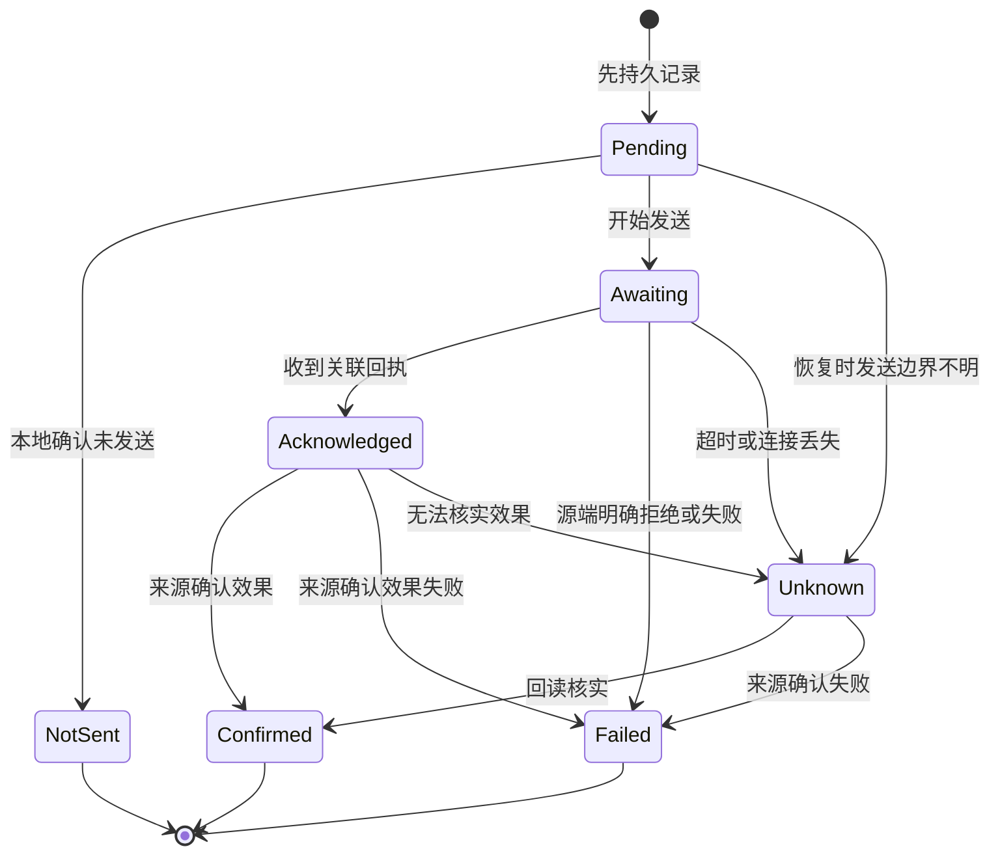

# 指挥客户端系统设计

- 文档 ID：`DESIGN-ENGINEERING-COMMAND-CENTER`
- 状态：`draft`；目标架构，局部实现与验证范围见 §11，完整产品验收未完成
- owner_role：`runtime_engineer`；产品归 `producer_system_designer`，Codex 接入归 `agent_engineer`
- module：`engineering`
- 上游：[指挥客户端产品设计](command-center.prd.md)、[PRD-ENGINEERING-034](../prd.md#PRD-ENGINEERING-034)
- 当前实现审读基线：`main@0ec10379419b0aaedb9d16157b81c92f4e6e3495`；初始设计基线 `7039bc376882ab8f84f88ca014f6d7ce642539a8`，既有方案 `56a33562436ffa4b65a66d05e61f26a849b16728`
- last_reviewed_at：2026-10-17
- 初始设计与评审来源：[PR #4518](https://github.com/eng-cc/oasis7/pull/4518)

本文把客户端形态、Rust 技术调研和架构方案收敛为一份系统设计。产品行为和验收由配对 PRD 主责；本文定义如何承接，不把目标状态写成已交付事实。通用授权、开发、验证和交付仍由 [workflow/source-of-truth](../workflow/source-of-truth.md) 主责，客户端内部状态不增加上游任务准入或审批门禁。

## 1. 问题、目标与非目标

客户端需要把分散的项目目标、规范理由、Git/PR/CI 和 Codex 开发现场放到同一可追溯上下文，解决负责人难以判断方向、回忆决定和管理并行执行的问题。系统最重要的性质是来源与操作正确性：部分读取不能变成“没有工作”，会话结束不能变成“目标完成”，重连不能重复发出模型输入。

当前实现把章节、PR、决定和协议表单直接交给用户组合，缺少可复用的工作上下文；来源读取时间也不足以证明摘要里的交付判断仍然有效。本设计补齐“首页判断—统一工作详情—原工具或自管执行—结果回读”，使一次用户操作得到可定位的结果或可继续核对的未知状态。来源索引、原任务身份和现有协议继续复用；新投影、关联修复及外部入口是目标合同，不能把现有原文页面称为完整基础首版。技术正确性和日常任务完成分别验证。

采用 **Tauri 2 + 独立 Rust 核心 + SolidJS / TypeScript strict / Vite + SQLite**。Rust 拥有领域、来源、持久化、索引、操作与运行时；TypeScript 负责呈现、输入和界面状态。生产形态为 macOS App，静态界面随包发布，Core 驻留 App；不需要用户在终端启动看板服务。[Tauri 进程模型](https://v2.tauri.app/concept/process-model/)支持这种系统 WebView 与 Rust Core 分工。

首版保留本地使用、可选 GitHub、版本受控的可选实验 Codex 连接器与未来远端边界；基础首版通过既有工具入口完成日常闭环，可独立于自管执行发布。来源/桌面基础可作为局部切片交付。完整 IDE、游戏 Viewer、游戏内 Agent 调度、公共网站、多租户平台、全机任务接管和无人值守执行宿主均不属于当前产品承诺。性能、系统版本范围和真实协议兼容性须由后续实现证据确认。

## 2. 上游约束与相关角色

产品负责人维护用户承诺及范围；系统实现维护领域、存储和生命周期；接入实现维护 GitHub/Codex 的版本与能力；验证工作覆盖对应条款的真实环境与故障情形。角色描述用于定位专业责任，不新建强制串行交接。

已有仓库与外部来源保持事实所有权。工程工具沿 engineering 专业域组织，产品四域、现行规范主责、Issue 可选和实际 PR/CI 交付方式不变。

### 2.1 需求承接与分配表

| 上游条款 | 独立义务与适用条件 | 本设计条款 | 外部 owner / dependency | 明确排除或未覆盖 |
| --- | --- | --- | --- | --- |
| Trace refs: O7-REQ-6e70287f-a156-4544-997d-5c1752e5efde；[REQ-CC-001](command-center.prd.md#REQ-CC-001) | App 独立启动，打开正确项目和工作树，恢复个人上下文；产品适用性：N/A；reason=开发指挥客户端的工作、来源及会话管理，不定义游戏玩家能力；scope=App 独立启动，打开正确项目和工作树，恢复个人上下文 | [DES-CC-001](#DES-CC-001) | [tests/foundation.rs](../../../tools/oasis7-command-center/core/tests/foundation.rs)；runtime_engineer；Tauri / 系统 Git | 不以游戏栈或终端后端为前提 |
| Trace refs: O7-REQ-2d1f3577-785e-40ac-8d25-ba0d414511f6；[REQ-CC-002](command-center.prd.md#REQ-CC-002) | 来源、版本、覆盖与失败分别保留；局部可用；产品适用性：N/A；reason=开发指挥客户端的工作、来源及会话管理，不定义游戏玩家能力；scope=来源、版本、覆盖与失败分别保留；局部可用 | [DES-CC-002](#DES-CC-002) | [tests/foundation.rs](../../../tools/oasis7-command-center/core/tests/foundation.rs)；各 adapter；上游查询能力 | 不推定完整全局快照 |
| [REQ-CC-003](command-center.prd.md#REQ-CC-003) | 当前与长期目标关联到适用验收，进度有可核实分母；产品适用性：N/A；reason=开发指挥客户端的工作、来源及会话管理，不定义游戏玩家能力；scope=当前与长期目标关联到适用验收，进度有可核实分母 | [DES-CC-003](#DES-CC-003) | [tests/foundation.rs](../../../tools/oasis7-command-center/core/tests/foundation.rs)；producer_system_designer；core PRD / 交付事实 | 不按提交数或活动量计算完成率 |
| Trace refs: O7-REQ-eb004bfb-41c7-4e8f-aa5b-1f52cec6cf08；[REQ-CC-004](command-center.prd.md#REQ-CC-004) | 规范效力、历史理由、个人决定与正式回写可区分；产品适用性：N/A；reason=开发指挥客户端的工作、来源及会话管理，不定义游戏玩家能力；scope=规范效力、历史理由、个人决定与正式回写可区分 | [DES-CC-004](#DES-CC-004) | [tests/document_lifecycle.rs](../../../tools/oasis7-command-center/core/tests/document_lifecycle.rs)；文档主责；显式替代与源版本 | 不另建通用决策登记系统 |
| Trace refs: O7-REQ-eb004bfb-41c7-4e8f-aa5b-1f52cec6cf08；[REQ-CC-004](command-center.prd.md#REQ-CC-004) | 决定版本、规范回写、实现同步及个人关注分别保存，旧数据恢复不复活已处理项；产品适用性：N/A；reason=工程客户端合同不定义游戏玩家能力；scope=决定版本、规范回写、实现同步及个人关注分别保存，旧数据恢复不复活已处理项 | [cc-decision-attention-state](#cc-decision-attention-state) | runtime_engineer；旧个人记录及具体证据来源 | 个人确认和停止关注不改源任务/规范/实现事实 |
| Trace refs: O7-REQ-a6126ad0-2f2d-47ad-a504-5e9ceff92cff；[REQ-CC-005](command-center.prd.md#REQ-CC-005) | 工作目的、PR/CI、持久会话与运行实例分别关联；产品适用性：N/A；reason=开发指挥客户端的工作、来源及会话管理，不定义游戏玩家能力；scope=工作目的、PR/CI、持久会话与运行实例分别关联 | [DES-CC-005](#DES-CC-005) | [tests/codex_runtime.rs](../../../tools/oasis7-command-center/core/tests/codex_runtime.rs)；agent_engineer；GitHub / Codex | 不将新连接当全机控制权 |
| Trace refs: O7-REQ-649217d9-4c9c-43fb-898e-4fd3606a0bf5；[REQ-CC-006](command-center.prd.md#REQ-CC-006) | 聚合真实问题，运行时请求使用原始身份；产品适用性：N/A；reason=开发指挥客户端的工作、来源及会话管理，不定义游戏玩家能力；scope=聚合真实问题，运行时请求使用原始身份 | [DES-CC-006](#DES-CC-006) | [tests/codex_runtime.rs](../../../tools/oasis7-command-center/core/tests/codex_runtime.rs)；真实请求方；已有授权 | 不将普通实现转为待批准 |
| Trace refs: O7-REQ-649217d9-4c9c-43fb-898e-4fd3606a0bf5；[REQ-CC-006](command-center.prd.md#REQ-CC-006) | 真正待回复、待核实及知悉变化分组，处理后返回原工作且重开可恢复；产品适用性：N/A；reason=工程客户端合同不定义游戏玩家能力；scope=真正待回复、待核实及知悉变化分组，处理后返回原工作且重开可恢复 | [cc-attention-projection](#cc-attention-projection) | UI 实现 / qa_engineer；原请求和个人处理记录 | 无可读接口时个人陈述不冒充外部回执 |
| Trace refs: O7-REQ-417e1bc6-1dac-4b80-891a-cef1f770bf55；[REQ-CC-007](command-center.prd.md#REQ-CC-007) | 动作受实际能力、环境和目标约束，回执说明结果；产品适用性：N/A；reason=开发指挥客户端的工作、来源及会话管理，不定义游戏玩家能力；scope=动作受实际能力、环境和目标约束，回执说明结果 | [DES-CC-007](#DES-CC-007) | [src/RuntimePanel.test.tsx](../../../tools/oasis7-command-center/ui/src/RuntimePanel.test.tsx)；agent_engineer；已核对版本协议 | 读取历史不赋予控制能力 |
| Trace refs: O7-REQ-417e1bc6-1dac-4b80-891a-cef1f770bf55；[REQ-CC-007](command-center.prd.md#REQ-CC-007) | 用户一次发起内部按步骤登记和发送，未知停步不重放，私有属性先落盘；产品适用性：N/A；reason=工程客户端合同不定义游戏玩家能力；scope=用户一次发起内部按步骤登记和发送，未知停步不重放，私有属性先落盘 | [cc-start-intent](#cc-start-intent) | agent_engineer；现有锁定协议与操作记录 | 不承诺上游幂等，不按 idle/sourceResolved 推断可重发 |
| [REQ-CC-008](command-center.prd.md#REQ-CC-008) | 不确定副作用持久保留，恢复不自动重发；产品适用性：N/A；reason=开发指挥客户端的工作、来源及会话管理，不定义游戏玩家能力；scope=不确定副作用持久保留，恢复不自动重发 | [DES-CC-008](#DES-CC-008) | [tests/codex_runtime.rs](../../../tools/oasis7-command-center/core/tests/codex_runtime.rs)；runtime_engineer；源端可核实事实 | 不承诺上游幂等或完整事件重放 |
| [REQ-CC-009](command-center.prd.md#REQ-CC-009) | 关窗留后台，完整退出明确处理自管活跃或未知工作；产品适用性：N/A；reason=开发指挥客户端的工作、来源及会话管理，不定义游戏玩家能力；scope=关窗留后台，完整退出明确处理自管活跃或未知工作 | [DES-CC-009](#DES-CC-009) | [tests/codex_runtime.rs](../../../tools/oasis7-command-center/core/tests/codex_runtime.rs)；runtime_engineer；进程所有权 | 不保证崩溃、强退、重启后继续 |
| Trace refs: O7-REQ-76d54ed7-4028-460a-b22b-37a9088ad245；[REQ-CC-010](command-center.prd.md#REQ-CC-010) | 中文短查询、IME、键盘、读屏和有界长列表可用；产品适用性：N/A；reason=开发指挥客户端的工作、来源及会话管理，不定义游戏玩家能力；scope=中文短查询、IME、键盘、读屏和有界长列表可用 | [DES-CC-010](#DES-CC-010) | [src/App.test.tsx](../../../tools/oasis7-command-center/ui/src/App.test.tsx)；UI 实现 / qa_engineer；真实 macOS | 浏览器模拟不证明系统体验 |
| [REQ-CC-011](command-center.prd.md#REQ-CC-011) | 缓存重建保留个人与未决数据，凭据和展示内容有边界；产品适用性：N/A；reason=开发指挥客户端的工作、来源及会话管理，不定义游戏玩家能力；scope=缓存重建保留个人与未决数据，凭据和展示内容有边界 | [DES-CC-011](#DES-CC-011) | [tests/codex_runtime.rs](../../../tools/oasis7-command-center/core/tests/codex_runtime.rs)；runtime_engineer；SQLite / Keychain | 不默认记录或上传完整会话 |
| [REQ-CC-012](command-center.prd.md#REQ-CC-012) | 本地先行，Codex 实验接入独立启停与降级，基础发布不依赖它；产品适用性：N/A；reason=开发指挥客户端的工作、来源及会话管理，不定义游戏玩家能力；scope=本地先行，Codex 实验接入独立启停与降级，基础发布不依赖它 | [DES-CC-012](#DES-CC-012) | [tests/codex_runtime.rs](../../../tools/oasis7-command-center/core/tests/codex_runtime.rs)；产品负责人；环境和协议能力 | 不把 stdio 或非实验 API 当生产支持承诺 |
| Trace refs: O7-REQ-ce7b612a-3316-4c40-9009-c0d295ff0ed6；[REQ-CC-013](command-center.prd.md#REQ-CC-013) | 首页聚合重点、成果、真实请求及返回工作，三场景可用；产品适用性：N/A；reason=开发指挥客户端的工作、来源及会话管理，不定义游戏玩家能力；scope=首页聚合重点、成果、真实请求及返回工作，三场景可用 | [DES-CC-013](#DES-CC-013) | producer_system_designer；主责文档/状态摘要与来源适配器 | 不随刷新运行模型或伪造排序、事实时间 |
| Trace refs: O7-REQ-fdf061f8-ebdf-46e3-91a5-a2311e2bcb93；[REQ-CC-014](command-center.prd.md#REQ-CC-014) | 明确关联复用、失效修复、统一详情及已有现场接续；产品适用性：N/A；reason=开发指挥客户端的工作、来源及会话管理，不定义游戏玩家能力；scope=明确关联复用、失效修复、统一详情及已有现场接续 | [DES-CC-014](#DES-CC-014) | application/domain、UI与受支持原工具定位 | 不从分支名移交运行控制，不自动合并个人/私有数据 |
| Trace refs: O7-REQ-fd3b34c6-4fb4-4614-8d7b-744a86d29c3a；[REQ-CC-015](command-center.prd.md#REQ-CC-015) | 本机工具作为独立辅助入口接续原工作；产品适用性：N/A；reason=开发指挥客户端的工作、来源及会话管理，不定义游戏玩家能力；scope=本机工具作为独立辅助入口接续原工作 | [DES-CC-015](#DES-CC-015) | 本机工具设计、context与既有 signer | 原暂停和私有隔离合同继续约束；工具不成为全部工作的前置 |
| Trace refs: O7-REQ-729d655d-d8a8-4c44-9ea7-32578dc10f3f；[REQ-CC-016](command-center.prd.md#REQ-CC-016) | 文档全局树、配对与覆盖透明；产品适用性：N/A；reason=开发指挥客户端的工作、来源及会话管理，不定义游戏玩家能力；scope=文档全局树、配对与覆盖透明 | [DES-CC-016](#DES-CC-016) | Rust 索引、文档 owner、Solid UI / QA | 不由树存在推断完成、全局完整或原生体验通过 |

## 3. 当前基线、目标状态与差距

下表针对文首固定源码基线，描述已读取的实现结构及其与目标合同的差距；不代替真实 macOS 交互、性能或产品验收。实现结果仍归对应 PR/CI，项目动态状态见[项目状态](README.md)。

| 对象 | 当前实现与证据 | 目标状态与差距 |
| --- | --- | --- |
| 工作与首页 | [work_projection.rs](../../../tools/oasis7-command-center/core/src/work_projection.rs) 与 `WorkOverview.tsx` 提供当前项目的 PR/公开自管会话来源工作列表、共享详情、多目标及分实例事实；[domain.rs](../../../tools/oasis7-command-center/core/src/domain.rs) 保存章节、决定、Git 字符串和手工关联；[App.tsx](../../../tools/oasis7-command-center/ui/src/App.tsx) 与 `SummarySources.tsx` 提供原文及摘要入口 | 增加原来源身份的 WorkItem 与字段级证据投影，首页、详情和关注共享同一结果；不建立新的任务主表 |
| 来源时效 | [github.rs](../../../tools/oasis7-command-center/core/src/github.rs) 读取最近最多 100 个 PR；摘要正文和 PR 列表分别展示 | 明确已读窗口、逐项补读、事实时间与字段 authority；新读取旧摘要不能显示为当前交付事实 |
| 决定与关注 | [lib.rs](../../../tools/oasis7-command-center/core/src/lib.rs) 保存已确认决定，正式回写/实现同步固定为 `notVerified`；UI 将已确认决定列入关注 | 三条决定状态与真正待响应请求分离，完成和失效均有依据；清缓存不会复活已处理项 |
| 宿主并发 | [commands.rs](../../../tools/oasis7-command-center/src-tauri/src/commands.rs) 的四个槽位最终在同一 Application Mutex 中执行扫描、GitHub、查询和保存 | I/O 在应用锁外，有界调度、短事务发布、迟到结果隔离；该结构风险尚未转化为原生性能测量 |
| 文档阅读 | 清单、目录、显式产品/专业树及阅读恢复已有实现，见[文档树设计 §11](document-tree.design.md#11-验证映射与实施顺序) | 阅读默认、二级诊断和完整树合同分别承接；不将局部树实现写为缺失，也不宣称全局完整 |
| 自管执行 | [codex/actions.rs](../../../tools/oasis7-command-center/core/src/codex/actions.rs) 分开建会话与发送输入，已有原实例绑定和未决操作 | 工作级 StartIntent 编排同一预览的明确发起，保留未知不重发；已有安全边界不扩大 |

2026-10-10 的初始选型及调研理由保留在 §12。运行时读取实际选定来源，不把历史阶段、包版本或工作列表永久作为当前状态。

## 4. 边界与结构

### 4.1 App、核心与外部来源

Trace refs: O7-REQ-6e70287f-a156-4544-997d-5c1752e5efde；承接 [REQ-CC-001](command-center.prd.md#REQ-CC-001) 的适用义务。

Tauri 宿主负责窗口、菜单栏、来源选择、系统通知、IPC 转接和退出协调。Rust 核心中的 `application` 编排打开项目、四视图查询和明确操作；`domain` 维护模型与关联；`adapters` 解码来源；`store` 管理三类本地数据；`runtime` 持有连接和自管子进程。领域不依赖 Tauri 类型、SQL 行或 Solid store，先用一个核心 crate 的模块边界。

项目通过登记 ID、可取得的 repository ID、环境、规范化工作树及 Git 公共目录识别；分支是属性，不是身份。首次选择验证真实仓库，路径失效后允许重新定位且核对项目身份；恢复时读取偏好与位置。多项目可切换，首版不做跨项目组织平台。

项目总览和执行上下文分别处理，承接 [REQ-CC-001](command-center.prd.md#REQ-CC-001) 的项目进入与恢复。`RepositoryScope` 只描述用户选定的共同仓库、默认阅读基线和获准工作树引用集合；它是读取范围，不是新的 Git 仓库、任务或运行控制身份。共同仓库先核对规范化 `git_common_dir`；不同 clone 仅凭 remote URL 相同不自动合并，须由用户明确加入并保留各自来源。

`ExecutionContext` 继续引用现有 `Project.id + environment + worktree path + HEAD`，发送时重新核对工作树与运行绑定。当前 `Project.id = digest(git_common_dir:root)`、个人键 `project.id:kind`、runtime scope `project.id:environment` 和私有绑定的 `registered_project_id` 保持原义。总览通过引用读取已选 scope，不重写这些键、不迁移决定或私有资料，也不将全仓概览的主线 HEAD 当执行工作树 HEAD。用户未选主线基线时沿当前工作树并明确提示，不能猜 main 指向的实际版本。

切换阅读范围只改变投影/返回位置；切换执行目标需要重新预览相应上下文，不能将未发送输入或旧请求隐式投给另一工作树。路径重定位验证共同仓库与原身份，不可核实时保留旧记录供选择恢复。旧客户端兼容及新增个人记录见 §10.2。

### 4.2 代码落点与职责

以下路径承载客户端实现。新增模块名是本设计的实施落点，不表示文件已存在；保持一个独立核心 crate，不抽出通用任务服务。

| 路径 | 职责 |
| --- | --- |
| `tools/oasis7-command-center/Cargo.toml`、`Cargo.lock` | 小型独立 workspace，成员 `core` 与 `src-tauri` |
| `tools/oasis7-command-center/core/src/` | 领域、应用、适配器、存储、运行时 |
| `tools/oasis7-command-center/src-tauri/` | 薄宿主、配置、production capabilities、打包 |
| `tools/oasis7-command-center/ui/` | 独立前端包、生成 DTO、有限 bridge、界面测试和 lockfile |
| `tools/oasis7-command-center/tests/fixtures/` | 文档、GitHub、Codex 和故障回放样本 |

| 现有落点 → 目标职责 | 具体改动边界 |
| --- | --- |
| `core/src/domain.rs` → `work_projection` / `source_facts` | 定义 WorkRef、逐字段证据、首页/工作详情 DTO；只从来源和个人选择生成派生视图 |
| `core/src/index.rs`、`github.rs` | 继续负责有界来源读取；补来源事件/观测/拉取时间、窗口与已知对象补读，不在 adapter 内决定目标完成 |
| `core/src/lib.rs` → 应用协调与存储接口 | 分离读取候选和提交，处理关系修复、决定同步证据、view revision；个人数据写入使用 record revision/CAS |
| `src-tauri/src/commands.rs` | 去除跨 I/O 的 Application 大锁；查询、刷新、保存走独立的有界通路，宿主仅转接类型化命令 |
| `core/src/codex/`、`src-tauri/src/runtime_commands.rs` | 保留现有版本/实例门控与操作记录，新增 StartIntent 的有限顺序编排，不改外部会话所有权 |
| `ui/src/App.tsx` → 首页、工作详情、关注及路由组件 | 由共享 WorkRef 进入详情，区分呈现、编辑草稿和来源状态；不在 JSX 再算一套完成/关注状态 |
| `ui/src/RuntimePanel.tsx`、`LocalTools.tsx`、`DocumentInventory.tsx` | 接入原工作返回上下文；配置/诊断按需展开，具体工具与文档树合同沿配对设计 |

实现时在根 workspace 明确排除应用路径，按 [Cargo workspace](https://doc.rust-lang.org/cargo/reference/workspaces.html) 规则维护独立锁文件。沿用仓库 Rust 与 Cargo/sccache 缓存策略，不改写 `CARGO_TARGET_DIR` 或为每项任务建新缓存；不依赖模拟器、游戏 Agent 协议或 Viewer 启动。

### 4.3 具体技术栈

| 层 | 选择 | 所有权与取舍 |
| --- | --- | --- |
| 桌面 | Tauri 2 受支持稳定补丁 | macOS 系统 WebView；生产静态资源，无常驻 HTTP / Node 后端 |
| UI | SolidJS、TypeScript strict、Vite | 四视图、输入、键盘、焦点、路由与显示状态 |
| 控件 | Kobalte、TanStack Solid Table / Virtual、CSS 变量 | 语义控件与按需虚拟化；简单列表不强加复杂组件 |
| 异步与错误 | Tokio、tokio-util、thiserror | 共享 I/O runtime、有界通路、取消与清晰错误 |
| DTO | serde / serde_json、ts-rs | Rust 定义；TS 类型生成、有限 bridge 和真实 JSON 契约各负其责 |
| 持久化 | SQLite、rusqlite bundled | 专用数据库线程独占连接；避免同步查询阻塞 UI 或协议 I/O |
| 文档与变化 | pulldown-cmark、notify | 结构化章节、受限渲染；事件提示配合重新读取 |
| 来源访问 | 系统 Git CLI、reqwest + rustls | 参数数组、机器输出；HTTP 超时、分页、条件请求和限额 |
| 凭据与诊断 | Keychain；keyring-core + apple-native-keyring-store；tracing | 明确平台 provider，凭据只在 Rust；诊断限量脱敏 |
| 验证与分发 | Rust tests、Vitest、WebdriverIO Tauri service；Tauri bundler / updater | 分层验证、macOS 安装包；更新按需加入 |

[Solid](https://docs.solidjs.com/concepts/intro-to-reactivity)、[Kobalte](https://kobalte.dev/docs/core/overview/introduction)、[TanStack Table](https://tanstack.com/table/latest/docs/framework) / [Virtual](https://tanstack.com/virtual/latest/docs/framework) 支持当前交互组合；选 Solid 的理由是适配工作负载和已有工程经验，未声称比 React 更快。[ts-rs](https://github.com/Aleph-Alpha/ts-rs) 只承担类型生成，不生成完整命令客户端或运行时校验。[rusqlite](https://github.com/rusqlite/rusqlite) bundled 统一 SQLite 构建，数据库线程、队列与事务公平性由应用实现。

具体 patch、MSRV、Cargo feature、插件兼容性和许可证组合在实现锁定时核对，不能把 `latest` 或 Viewer 声明范围当作已验证锁定组合。当前不引入 ORM/数据库池、向量库、SSR、生产 Vite 服务或通用插件框架。

## 5. 关键运行流程

### 5.1 打开项目、索引规范与记录决定

Trace refs: O7-REQ-eb004bfb-41c7-4e8f-aa5b-1f52cec6cf08；承接 [REQ-CC-004](command-center.prd.md#REQ-CC-004) 的适用义务。

打开项目后，按 [项目地图](../../../skills/oasis7-command-center/references/project-map.md) 找到当前主责入口与显式引用；目标读取 core PRD 当前阶段章节，规范效力读取主责身份、范围和替代关系，不按 mtime 排序。已提交基线和 dirty 工作树分别索引与展示，切分支或修订变化使相关投影失效。

[pulldown-cmark](https://docs.rs/pulldown-cmark/latest/pulldown_cmark/) 产生可定位的标题、段落、表格、代码与链接块；解析语法不自动决定条款效力。已有条款 ID 优先，标题定位须处理重复；行号只辅助跳转。保存原版本引用与可取得内容，历史工作可回到当时条款并找到明确后继。

按真实阅读版本计算“自上次查看变化”；没有历史内容或明确阅读记录时说明缺口。用户决定草稿、已明确决定、正式条款更新、实现同步分别记录。首版通过原文编辑入口或明确的 Codex 工作回写主责文档，只以实际结果更新来源；保存草稿不改规范效力，也不创建另一个通用决策 registry。

决定的三条状态、证据和终态遵守 [§7.4](#cc-decision-attention-state)。确认意图仅改变决定状态；后续补理由、关联来源或查看决定均不改原确认时间。正式回写和实现同步分别记录适用范围及证据，来源中未发现关联只表示未核实，不能让该决定永久出现在“需要我决定”。

[notify](https://docs.rs/notify/latest/notify/) 事件只提示失效，合并去抖后重读。初次载入、唤醒、重新聚焦、手动刷新和检测到遗漏时校准；必要时受限轮询。不索引 `target`、`node_modules` 或 Git objects，不能把全目录递归监听当作一致性保证。

### 5.2 Git、GitHub 与刷新发布

Git 采用 [status](https://git-scm.com/docs/git-status) 的 `--porcelain=v2 -z --branch`、[worktree](https://git-scm.com/docs/git-worktree) 的 `list --porcelain -z` 等机器输出。Rust 用参数数组、明确 cwd、超时和输出上限调用，处理空格/换行路径与 detached HEAD。读取不隐含 fetch、切分支、reset、提交或清理；本地远端引用只是最近所知状态。

GitHub 优先经 `gh api --method GET` 调用 REST，不使用 `gh repo view`、`gh pr list` 等隐式 GraphQL 查询。仓库定位读取选中工作树的 GitHub origin 并用 REST 仓库身份核实；默认仅取 PR 列表第 1 页、最多 100 项，不批量展开所有 PR 的检查或评审。用户在工作详情明确读取某个 PR 的 CI 时，才对其原 HEAD 有界读取 check-runs 与 combined statuses 各第 1 页、每页最多 100 项，保存各自真实 tested SHA、读取时间和截断范围；未读取不作成功空或评审通过。PR HEAD 或项目/来源 generation 变化时，丢弃迟到的 CI。触及限额时保留旧事实并明确提示，不自动重试或回退 GraphQL。继续复用固定只读参数的 gh adapter；扩展分页或改用共享 reqwest Client 时仍按 host/account 绑定，并遵循[条件请求、分页和退避建议](https://docs.github.com/en/rest/using-the-rest-api/best-practices-for-using-the-rest-api)。桌面首版没有公网 webhook 接收服务，使用克制轮询，优先当前可见与显式关联的 PR/检查；Issue/Project 按需。近期列表没有包含某个已知 PR 时，详情可在该来源获准且有能力的条件下按其真实身份补读；列表截断、404 和未读取分别保留，不能由缺席推断未合入或删除。

初始刷新预算：每个 Git/gh 子进程或 HTTP 请求最多 10 秒，单来源刷新总期限 30 秒；列表每页最多 100 项、一次最多 10 页，已知对象补读一次最多 20 个且计入同一总期限。当前 gh 仅最近 100 PR 的能力不因此扩大为已实现分页。到达页数/时间预算返回已读范围和剩余 cursor/原因；用户明确“继续读取”开启有界新尝试，不能在后台无限追页。限额按来源返回的 retry-after 显示下次可重读时间，不在截止后持续等待或忙重试；分页期间来源变化保留各页实际版本/时间，不宣称原子快照。

一次刷新按“读取候选 → 核对版本/范围 → 事务应用 → 发布 view revision”处理。慢 generation 不能覆盖新快照。分页记录时间范围与完整度；即使页已读完，也不宣称各字段属于同一瞬间。403、404、限额、超时、部分页和成功空结果分别处理，失败保留最近成功数据。

### 5.3 工作操作与待处理请求

Trace refs: O7-REQ-649217d9-4c9c-43fb-898e-4fd3606a0bf5；承接 [REQ-CC-006](command-center.prd.md#REQ-CC-006) 的适用义务。

用户从目标或工作选择明确范围、依据版本、环境与连接能力，应用准备相应操作；真正启动、输入或中断经核对版本与能力的 Codex 连接器执行，新工作准入和停用后的既有工作管理遵循 §6.4。看板不复制 Agent 执行循环，也不自动分发所有未完成目标。

运行时反向请求按真实 runtime/request/thread/turn 身份登记，包含背景、可选输入及影响；重复投影同一问题可以聚合，多次独立请求不能因文字相同而合并。展示普通提醒与真实阻塞的区别；已授权实现继续按既有授权推进，不加看板总审批。处理结果由回执与来源确认，刷新不重复回复。

Trace refs: O7-REQ-649217d9-4c9c-43fb-898e-4fd3606a0bf5；承接 [REQ-CC-006](command-center.prd.md#REQ-CC-006) 的关注呈现、处理与恢复。

关注区按 [PRD 关注闭环](command-center.prd.md#cc-attention-lifecycle) 消费统一 `AttentionItem` 投影：需要用户输入的真实请求、待核实事实、知悉变化分别查询。`DecisionRecord.confirmed_at` 存在不构成待处理条件。每项需回复事项绑定原请求或一项明确的用户待定问题、所属 WorkRef、仍有效的待答理由及可用动作；缺少背景时允许先进入详情，不能用连接设置页代替问题处理。处理后详情和首页由同一已提交 revision 更新，结果未知进入核对状态，终态保留原证据但退出待答列表。

### 5.4 关闭、完整退出与恢复

| 事件 | 本 App 自管运行时 | 外部运行时 |
| --- | --- | --- |
| 关闭主窗口 | 保留菜单栏入口和必要连接，任务继续；可降低只读轮询频率 | 只改变观察，不发送停止 |
| 停用实验连接器 | 先拒绝新工作；活跃或未知时保留原实例管理与必要恢复，确认无活跃/未知后回收空闲服务 | 停止新接入；既有连接的退出不改变外部任务所有权 |
| 完整退出且确认没有活跃工作 | 停止接收新动作，保存状态，结束空闲自管服务并回收子进程 | 断开本客户端连接 |
| 完整退出且有活跃或未知工作 | 留后台、等待结束后退出、明确停止后退出；默认不停止 | 所有权仍在外部，不随退出发送停止 |
| 明确停止目标 | 请求正确实例/目标，核对实际停止结果 | 仅在目标确实可控且已授权时执行 |
| 崩溃、强退、系统重启 | 不保证继续；恢复事实与未决操作，不重跑 | 外部宿主负责执行；重连核对实际状态 |

活跃范围含生成、等待输入/批准及可核实的后台命令；`turn/completed` 不证明所有后台工作结束。无法观察后台范围即保留未知；中断已接受也不证明结束。等待退出期间不再接收新副作用，仍处理既有协议控制与状态。停止失败或未知时恢复可操作说明，不显示“已安全结束”。

退出协调属于 runtime/application，组件卸载、路由变化和取消订阅不能触发它。若多个项目/环境共享自管进程，回收前核对该进程的全部工作和其他仍在使用的连接，不能只因一个项目停用就回收整个进程。遵循 [Tokio 关闭协调](https://tokio.rs/tokio/topics/shutdown)，对子进程显式关闭并 wait/reap；[Child drop](https://docs.rs/tokio/latest/tokio/process/struct.Command.html) 不是任务持久性策略。App 更新重启使用同一退出机制。

### 5.5 持续状态维护与架构阅读

按[持续更新流程](command-center.manual.md)维护两个派生仓库入口：`command-center/README.md` 承载长期/短期目标、当前进展、近期变化与人工关注；`command-center/architecture/README.md` 承载关键设计与部署索引。两者通过原有文档适配器读取并下钻源条款，不建立第二套任务表、产品权威或部署库存。

来源事实改变后，负责当前工作或回顾的执行者核对影响，在已有授权内维护主责和摘要；普通客户端刷新仅重新读取，不能自行写入仓库、创建 PR、SSH 采样或启动模型。合入后状态在下一次刷新协调，不为每次合入递归生成状态 PR。目标、已合入代码、实际测试、部署、目标验收使用各自来源。

摘要声明的文档基线、来源观测窗口与实际环境核验分别保留。文件索引的 revision/读取时间只说明读取了哪个摘要版本；没有读取其引用的 PR/环境，不能刷新其内部事实时间。原始内容中缺少时间、覆盖或来源时展示缺口，不推测。当前只有通用文档检索/来源入口，属于阅读基础；§5.6 的专用首页聚合及事实时效解释仍须实现与验证。后台采集不是本轮基础首版的必需能力，不由本节文字宣称完成。

架构索引从事项进入原有主责条款，分别展示设计边界、已有实现与实际部署证据。显式后继读取沿 §11.0.2 复用；索引条目不能仅凭文档 active 或引用关系成为权限、写入权、部署就绪或完成证明。历史清单保留原采样日期，未知环境状态不补造实时拓扑。

### 5.6 首页判断投影

Trace refs: O7-REQ-ce7b612a-3316-4c40-9009-c0d295ff0ed6；承接 [REQ-CC-013](command-center.prd.md#REQ-CC-013) 的适用义务。

application 在既有来源快照之上生成 `HomeProjection`，四个区域及默认交互由 [REQ-CC-013](command-center.prd.md#REQ-CC-013) 与[首页布局](command-center.prd.md#cc-home-layout)主责。目标定位沿 core 当前阶段及显式主责引用；状态摘要沿现有稳定章节读取，复用 Markdown 块和链接，而非把文件全文直接放到首页。摘要无法结构化提取时提供该区正文的阅读入口及覆盖说明，保留其他已解析区域；只完成该降级不能宣称首页整体验收通过。

投影中的每个结论分别保留原文定位、源 revision、事实性质、摘要内部核验时间和读取时间。已核实 PR/CI 更新其对应字段，不覆盖主责目标；与摘要冲突时保留双方版本及冲突字段，不用一个“最新时间”覆写整条记录。摘要自己的归纳不升级为运行事实。

重点排序输入只有主责显式阶段顺序、用户已保存置顶及组内来源顺序；缺少优先级时保留并列。下一步引用现有主责或个人选择，分析建议单独带性质且不改变源关系。近期结果按明确 PR/交付身份聚合，保留事件时间和比较基线。待处理投影复用原请求身份和 §5.3 的已处理结果；人工关注、事实缺口和普通提醒分组，观察不全不生成虚构请求。

| 分区 | 投影输入与输出 | 缺口/动作边界 |
| --- | --- | --- |
| 当前重点与下一步 | 目标原条款、已核实成果、剩余条件、显式下一动作、关联 WorkRef；默认最多三项，其余可展开 | 无明确排序保留并列；不从 PR 数量推算优先级，不让用户先填写关系才显示可读取目标 |
| 最近成果变化 | 按用户选择的比较窗口、事件身份与适用版本聚合真实结果，链接同一工作 | 同一 PR 的提交/检查/合入不重复算成果；没有事件时间则不伪入窗口，改列“本次新观察到”并说明时间未知 |
| 需要我处理 | §7.4 的仍需用户回答事项与数量，事实缺口和知悉信息分组 | 没有真实待答项可以为空；来源不可用显示该范围未知，不能显示“全部处理完” |
| 返回工作 | 已确认工作关系、用户近期进入位置和未发送草稿存在性 | 不包含私有正文、秘密或私有线程；没有历史时给可读工作入口，不创建空任务 |

`HomeProjection`、`WorkDetailProjection` 和 `AttentionProjection` 从同一已提交来源集合及个人记录 revision 生成，并发布共同 `viewRevision`。各区返回自己的可用/部分/旧结果和缺口，来源集合并非原子远端时刻；一处失败不清空其他区。投影缓存键包括 schema、RepositoryScope、实际阅读基线、来源 revision 集合、个人记录 revision 和比较窗口，缓存缺失可重算。一次保存/处理成功使相关投影失效；旧计算结果提交前须核对全部输入 revision，不能重新引入已处理问题。

项目选择和连接配置只在首次打开或用户展开时占据主要空间；身份、SHA 和诊断按需展开，当前判断受影响的具体缺口直接显示。查询先返回已验证身份下的最后成功投影及分区状态，再异步校准来源；新恢复路径未完成身份校验时只提供带“待核对”标记的安全阅读，不开放执行。后台全量扫描不作为每次 `query_view` 的前置。

### 5.7 统一工作详情、关联与原工具接续

Trace refs: O7-REQ-fdf061f8-ebdf-46e3-91a5-a2311e2bcb93；承接 [REQ-CC-014](command-center.prd.md#REQ-CC-014) 的适用义务。

application 以 §6.2 的 WorkItem 原来源身份构造[统一工作详情](command-center.prd.md#cc-work-detail)。首屏先返回工作目的、当前可核实结果、主要剩余条件和可用下一动作；来源/目标关系、PR/CI、会话、真实请求及操作回执作为同一详情的区域。原文、完整 SHA、协议身份和诊断可展开，不抢占首屏判断。不同视图只传相同工作引用和返回位置；详情不创建新任务表或将多个源状态压成统一完成值。未产生 PR 的明确会话仍可作为工作入口，后续取得显式 PR 关系再关联到原工作。

关联保存来源双方身份、原依据版本、关系种类、提出方式（源明确引用、用户确认或建议）、适用工作树及当前可定位性。读取到 URL 只证明链接存在；只有正文明确表达的服务目标、验收或会话关系才能投影为该语义。候选查询优先当前工作已有关系、来源明确引用和用户选择范围，不默认展开上百个全仓复选框。相同端点/种类/范围关系去重，重复刷新只更新观测；具体修改、冲突和移除沿 §7.5。采用个人决定的回写证据仍引用真实源 revision，未知同步结果不自动转为已完成。

外部会话入口先使用已支持且获准的来源接口或用户明确保存的引用；详情分别显示历史读取、实时观察、原工具打开、控制能力。没有会话能力时保留 PR/工作树定位与缺口。导航校验复用有限来源打开命令及允许的协议/目标，不能运行任意 shell 或解析私有库来宣称接管；没有受支持的深链就提供可复制定位和实际原工具入口，不伪造跳转成功。新入口格式需独立校验，不能把任意文档 URL 作为命令执行。

自管动作复用已有 start/input 及操作账本，单次发起合同见 §5.8。连接/能力不可用时仍能回原工具，不用启用实验连接器作为打开已有工作的前置。原工具打开结果只证明操作系统接受了该导航请求；返回 App 后按原 WorkRef 重新读取有权取得的事实，不因此标记任务完成。

返回位置、筛选和未发送草稿绑定工作来源身份、项目/环境及适用运行目标；切换视图不重新录入。普通草稿默认会话内保留，用户明确选择留存后才进入个人存储，支持删除；重开只恢复所选普通草稿且不发送。私有资料引用及秘密回复沿原隔离与保存边界，恢复普通工作草稿不自动持久化私有正文或秘密。来源变更后提示具体差异，重新核对实际目标后才开放动作。

### 5.8 一次明确发起与结果回读

Trace refs: O7-REQ-417e1bc6-1dac-4b80-891a-cef1f770bf55；承接 [REQ-CC-007](command-center.prd.md#REQ-CC-007) 的一次发起与操作结果。

[PRD 发起工作](command-center.prd.md#cc-start-work)对应有限应用命令 `start_work`。`StartIntent` 是一次用户输入的本地操作组合，复用现有 operation 身份与子步骤记录，不成为另一套开发任务。它包含原 WorkRef、ExecutionContext、目的/范围、依据版本、实际发送预览的摘要及当前获准 runtime 目标；目的/范围元数据不能代替实际输入，更不能升级权限。

1. 用户在工作详情修改同一份预览并明确发起。Rust 重新核对项目/工作树/HEAD、输入预算、连接版本/能力、目标和已有授权；不兼容返回具体可修复原因，保留草稿。UI 抑制同一意图重复点击，Rust 按本地 operation 身份拒绝重复受理。
2. 先持久记录意图及预定步骤。需要新会话时记录并执行 `thread/start`；已有可用自管会话时复用其真实 thread，不以同分支推定目标。私有资料的实际输入 frame 必须等真实 thread 已知且线程私有属性已持久保存后才可发送，保存失败则不发送。
3. 建会话回执核实、真实 thread 与原实例已保存后，才为同一预览记录并执行 `turn/start`。前一步已确认而后一步确认未发送时，显示“会话已建立，输入未发送”，允许在该会话明确续发；不重新建立会话。拒绝或失败分别保留来源结果。
4. 任一步发送边界或回执不明时停止后续自动推进，显示“结果待核实”，按原 operation/instance/thread/turn 回读。重连、重开、超时、来源刷新和用户再次打开详情均不重发；无可核实身份时保留未知，不按标题搜索一个会话认领结果。
5. 回执、已开始一轮、该轮结果、PR/CI 和目标验收分别更新详情；成功发送仅退出发送表单，不清掉未被核实的工作剩余条件。原 preview 若未获准持久保存，重开只恢复操作元数据和核对入口，不从日志重建私有/秘密输入。

本地去重只能抑制本客户端已知的重复操作；上游没有幂等保证时不能声称 exactly-once。明确重试仅适用于已证明未发送，或上游明确拒绝且能核实未产生该步效果的步骤，并形成新的可追溯操作；仍未知时不可用“重试”掩盖可能已有的副作用。现有 `sourceResolved` 仅证明原实例已无可观察活跃工作，原输入效果仍未核实；它及 `idle`、中断完成均不成为可重放输入的证据。未知 `thread/start` 没有 thread ID 时不补造身份。已有创建会话与输入分离接口继续兼容，但基础产品默认入口采用上述一次发起。

## 6. 接口与数据合同

### 6.1 来源合同与错误

Trace refs: O7-REQ-2d1f3577-785e-40ac-8d25-ba0d414511f6；承接 [REQ-CC-002](command-center.prd.md#REQ-CC-002) 的适用义务。

关键对象包含 `SourceRef`：来源类别、主机/账号/环境、对象身份、可得 revision、事实性质与 coverage。事实性质区分源事实、Agent 汇报、模型归纳、用户选择和待核实关联。未取得的字段保留未知，不生成伪造时间或身份；[产品来源状态](command-center.prd.md#cc-source-states)所需字段在 Rust 统一产生，不由各页面自行解释。

| 字段组 | 语义与更新条件 |
| --- | --- |
| `sourceRevision` / `observedAt` | 实际读取的源版本与该事实被来源/采样者核实的时间；摘要正文有独立核验时间时保留它，缺失则未知 |
| `fetchedAt` / `lastAttempt` / `lastSuccess` | 本 App 拉取、尝试及成功读取的本地时间；重新读到同一旧正文只更新读取元数据，不改变正文事实的 `observedAt` |
| `eventAt` / 事件身份 | 合入、测试完成或其他来源明确事件的实际时间；未知时不能用文件 mtime、拉取时间或排序位置替代 |
| `coverage` | 仓库/账号、选定工作树/基线、对象或查询范围、已读页及游标/窗口、截断/遗漏/失败原因；“查询空”只在成功且该声明范围完整时成立 |
| `generation` / `viewRevision` | 本地读取代次和已提交投影版本；只比较同一来源键/读取范围的代次，不把本地计数当上游事件顺序 |
| `FactCell<T>` | 值、原 SourceRef、依据版本、事实性质、适用范围、核实/旧结果/冲突/未知状态及原因；每个结论可独立回溯 |

时间统一存可解析 UTC 值及来源时区/精度信息，UI 按用户时区呈现；没有上游时间时保留空值。不同来源时钟与精度不足以证明严格先后，不用“最近读取”覆盖跨源冲突。`stale` 必须带原因：如关联源已出现新版本、超出该来源声明的有效窗口、刷新失败沿用上次结果；仅有日期较老而无时效合同的规范不能自动退役。日期范围变化使成果窗口重新投影，不能改写历史事实。

| 字段 authority | 可更新的字段 | 不得顺带推出 |
| --- | --- | --- |
| 当前主责文档/明确验收条款 | 目标、适用条件、规范效力及显式下一步 | PR/CI 现状、实际部署或验收通过 |
| 派生状态摘要 | 其原核验窗口内的说明与判断，保留摘要性质 | 新拉取时即为当前事实，或凭摘要修改正式要求 |
| Git / GitHub | 对应工作树状态、PR source HEAD、PR 状态、真实事件；CI 的测试对象/结果按返回的实际字段保存 | 未读页没有工作、合入代表部署或整体目标完成；缺 tested OID 时声称测试覆盖新 HEAD |
| 原运行时/操作回执 | 原实例/thread/turn/request 的观察及该操作结果 | 所有外部会话状态、所有后台工作结束或产品验收 |
| 用户明确选择/确认 | 置顶、个人计划、关系与有证据的核实结论 | 改写源状态、接管会话或授予新权限 |

读取到比摘要窗口更新的 PR 合入事实时，用它展示该 PR 的状态和事件；摘要旧的“待合入”保留为过期依据，并指出冲突字段。目标、部署和验收仍保留各自来源，不能整条记录 last-write-wins。两个来源对同一权限范围内的字段冲突而无法判定时并列双方依据，将受影响结论设为待核对；其他字段继续可用。

来源加载、成功空、部分、旧结果、错误、未接入分别可见。错误 DTO 返回 `category`、受影响来源/字段、最后成功范围、必要诊断引用和有限 `recoveryAction`，区分未安装、未认证、无权限、目标不在覆盖范围、限额、超时、存储故障及版本冲突；UI 在原操作附近提供打开配置、重读该来源、查看原工具或解决冲突的具体入口。适合重读不等于适合重发副作用，不能仅凭 `retryable` 自动重发输入。

ID、Git OID、外部节点和本地 cursor 用明确字符串表示；可能超出 JavaScript 安全整数的值使用约定字符串等 JSON 编码。ts-rs 的 TypeScript `bigint` 不代表 JSON 自动转换。Rust 在实际协议入口解码，bridge 验证命令/参数/错误与 DTO 的 JSON 往返。

### 6.2 目标、规范与交付关联

| 对象 | 身份与关联规则 |
| --- | --- |
| Goal / Milestone | 引用当前主责条款、长期/当前阶段及显式关系；身份沿源文档/条款，不按首页卡片另发目标 ID |
| Rule / DocumentSection | 仓库/阅读范围、路径、条款 ID 或稳定章节定位、revision/content hash、适用范围及后继；标题/行号变化不自动替换历史依据 |
| WorkRef / WorkItem | WorkRef 为来源命名空间与原对象身份：GitHub host/repository/PR 或 Issue，或原会话 SessionKey。WorkItem 是目的、关联目标、规范、PR/CI、会话、请求、证据和可用动作的派生组合；PR 无 Issue 仍独立成立，分支不作主键 |
| EvidenceLink | 引用真实源对象/版本、适用 AC/范围与结果性质；有 URL 仅证明链接存在，相关性和结论核实另行记录 |
| DecisionRecord | 保留原决定 ID、内容/理由/范围、确认时间与修订；决定本身、规范回写、实现同步三条状态及各自证据独立，见 §7.4 |
| 状态摘要 / 架构索引 | 普通仓库文档及其稳定章节；记录派生性质、来源基线/核验时间/范围，引用 Goal、WorkItem 和主责条款，不创建新的目标或任务身份 |
| 首页 / 工作详情投影 | 组合已有身份及结果；各结论保留来源，项目总览不隐去工作树与环境边界 |
| 关系定位与修复 | 原始双方身份及版本、关系种类、提出/确认来源、记录 revision、解析状态和移除标记；见 §7.5，不删除原依据 |
| 原工具入口 | 工具/来源命名空间、环境和明确定位；可打开、可观察、可控制分别判断 |

同一工作可服务多个目标；建议依赖不自动成为阻塞。仅当适用验收集合、分母与结果均可核实时显示验证比例，未核实部分单列。文档 active、PR merged、CI passed、turn completed、部署和目标验收各说明自身事实，互不代替。

显式关系可以把同一 PR 的多个会话组合到一个详情，仍保存全部原 WorkRef/SessionKey；同分支或同标题不证明属于同一工作。没有 PR 的会话先以原会话引用展示，后续出现明确 PR 关系时旧入口可转到该组合详情，原引用和返回位置继续有效。关系有歧义时保留独立工作和候选，不分配“统一任务 ID”来掩盖不确定性。临时输入预览只有草稿/operation 身份，未产生源工作前不计为进行中成果。

PR source HEAD、实际测试 SHA、main 前进和验收分别关联：旧 SHA 绿灯不覆盖新提交；main 前进也不自动否定同一 source HEAD 的适用 CI，解释服从当前流程主责。

### 6.3 会话身份、运行绑定与 Codex 边界

Trace refs: O7-REQ-a6126ad0-2f2d-47ad-a504-5e9ceff92cff；承接 [REQ-CC-005](command-center.prd.md#REQ-CC-005) 的适用义务。

持久 `SessionKey` 由来源存储/配置命名空间、环境及 thread/session ID 构成；同一会话可以有多个运行绑定。活跃状态按 `runtime instance + thread + turn` 保存，分支或会话标题不能用于去重；一个实例 idle 不覆盖另一个实例 active。

工作级关联沿 §6.2 的原 WorkRef 和 §5.7 的共享详情读取；详情可以包含多个 SessionKey/运行绑定，但不能因组合显示改变原对象身份或控制权。会话结果更新其对应事实字段，不直接更新目标完成值。

连接分别声明历史可读、实时可观察、可控制及具体范围。新 app-server 的已加载状态不能证明其他 App/CLI/IDE 的运行状态；读取历史不自动 resume/fork 或获取控制。外部连接按实际支持复用，不以私有数据库/JSONL 解析作为默认协议。

本客户端把 app-server adapter 定义为 **experimental、optional**，默认不为尚未启用的项目/环境建立连接或启动进程；用户明确启用后才按锁定版本试用。这个发布等级属于本客户端连接器，与协议的 `capabilities.experimentalApi` 开关分别管理。试用优先 stdio，并保持 `experimentalApi=false` 或省略该能力；需要实验方法时另行评估其具体用途，不能因连接器已启用就全量开启实验 API。

2026-10-10 核对的[官方文档](https://learn.chatgpt.com/docs/app-server#connect-a-remote-code-mode-host)在远端 Code Mode host 一节同时说明 app-server 命令和 WebSocket 传输的实验性及生产使用限制；同页另有[非实验 API 范围](https://learn.chatgpt.com/docs/app-server#experimental-api-opt-in)。后者及 stdio 默认传输均不能证明本产品集成已获得生产支持，因此本设计不把限制推定为仅适用于远端，也不承诺该连接器已生产受支持。

每个连接记录实际版本、传输、初始化结果、可用方法、支持范围来源及核对时间；从实际锁定版本生成 schema 用于契约回放，接口变化限制在 adapter。连通性、API capability、上游支持范围与本客户端发布等级分别判断；版本兼容测试通过不自动升级发布等级。稳定化条件见[重新决策条件](#CC-CODEX-PROMOTION)。

Rust runtime 持有自管 child、stdin writer、stdout reader、限量 stderr 与 request map，正确处理双向请求/响应/通知。沿用所选环境已有官方登录态，缺失时走该版本支持的官方认证；客户端不另存 ChatGPT 密码。必要字段不兼容时局部报错，未知非关键字段可容忍，其他来源继续工作。

### 6.4 应用 IPC 与能力校验

Trace refs: O7-REQ-417e1bc6-1dac-4b80-891a-cef1f770bf55；承接 [REQ-CC-007](command-center.prd.md#REQ-CC-007) 的适用义务。

下列是本应用计划的命令族，不是声称 Codex 存在同名方法。

| 命令族 | 示例 | 合同 |
| --- | --- | --- |
| 项目与查询 | `open_project`、`query_view`、`search_rules`、`read_source` | 返回范围、revision、分页与来源 |
| 刷新和订阅 | `refresh_source`、`subscribe_view`、`ack_batch`、`unsubscribe` | 只读或观察；刷新不启动模型或修改 Git |
| 执行 | `start_work`、`send_input`、`interrupt_turn`、`answer_runtime_request` | 验证授权、能力、环境、原运行目标；返回 operation ID |
| 个人数据 | `save_preference`、`save_decision_draft`、`confirm_link` | 保存用户明确动作；不改写源端交付状态 |
| 导航 | `open_source_target` | Rust 校验项目范围、规范化路径和 URL 协议 |

基础闭环增加的有限命令沿现有 bridge 生成/核验 DTO，不暴露通用 SQL、shell 或任意协议调用：

| 命令/方向 | 身份、版本与输入边界 | 成功、冲突及恢复 |
| --- | --- | --- |
| `query_home` / `query_work_detail`：Rust → UI | schemaVersion、RepositoryScope、WorkRef、可选 viewRevision；分页 cursor 绑定范围/筛选/快照 | 返回分区 FactCell、来源健康与能力；旧 cursor 明确失效，仅重查有关列表，不清掉返回位置 |
| `query_work_candidates`：Rust → UI | 原 WorkRef、关系种类、选定目标范围、有限 query/cursor | 已有/明确/建议分组并带依据；默认每页最多 50 项，结果不足不自动扫描私有资料或外部会话存储 |
| `confirm_link` / `repair_link` / `remove_link`：UI → Rust | 原端点/范围、关系种类、expectedRecordRevision、明确选择 | 事务 CAS；冲突返回当前记录和差异，保留用户选择供重新核对；不自动改源文件或PR |
| 决定与同步证据保存：UI → Rust | 原决定 ID、expectedRecordRevision、修改轨道、EvidenceLink/适用范围 | 原确认信息不可被普通编辑重置；失效证据转待核对，保存失败保留草稿，不静默覆盖 |
| `start_work`：UI → Rust | §5.8 的明确 StartIntent；实际输入沿现有 32 KiB 上限、目的/范围沿现有有界校验 | 返回 operation 和各步骤状态；结果未知只核对原操作，不能将前端重新请求当自动重发 |
| 原工具/来源打开：UI → Rust → 系统 | 已保存 WorkRef、允许的目标协议、真实环境和经验证定位 | 不支持深链时返回复制定位/原工具入口；系统接受打开请求不证明工具已定位或工作已完成 |

上述查询可重复执行而无写入；关系和决定修改必须带旧版本，操作命令使用原操作合同。每个响应包含实际应用的范围，不能仅用当前页面选中项解释晚到响应。未知 DTO/schema 明确返回 unsupported，同包 UI 不猜字段含义；既有 IPC 保持原响应 shape，新增详情命令独立演进。

Rust 边界不能信任前端提供的“已授权”“可控制”布尔值，应核对已有授权事实、连接能力和目标。新连接/新任务同时检查该项目/环境的实验启用状态；停用后的现有工作管理独立保留原目标核对、必要输入、明确中断和仅为收尾所需的恢复连接，不能用一个全局 enabled 判断把这些入口一并屏蔽。副作用与请求回复绑定原 runtime instance 及上游对象；重连先核实绑定，不因持久 thread ID 相同自动移交控制。

查询使用 command，有序增量使用 Channel，Event 仅作少量失效/状态提示；[Tauri 文档](https://v2.tauri.app/develop/calling-frontend/)明确区分这些用途。先发带 revision 的快照，再发 subscription ID、本地序号与范围的批次；这些游标仅服务 UI，不是上游重放保证。

## 7. 状态、事务与持久化

### 7.1 三类本地数据与事务边界

| 数据组 | 内容 | 清理与恢复 |
| --- | --- | --- |
| 可重建快照 | 章节、FTS、PR/CI 投影、已读取会话摘要 | 可分来源重建；保留最近成功时间与范围 |
| 个人持久数据 | 布局、筛选、阅读版本/位置、手工关联、草稿及已确认未回写的 DecisionRecord | 独立备份与迁移，索引清理不得删除 |
| 操作记录 | operation、原目标、上游回执、未知结果、待协调关联 | 重开仍保留，已协调后才按保留策略清理 |

采用一个 SQLite 文件分组，数据库层仍需维护 schema 兼容；本增量优先使用 §10.2 的独立版本化键，维持现有 `user_version=2`。新增投影及个人记录的写入由同一数据库协调通路拥有，其工作线程独占该通路的 rusqlite 连接，经有界请求/oneshot 服务；既有 runtime 和 ToolJobs 连接继续沿各自短事务、版本及实例条件写合同，不声称整个应用只有一个 writer。写入设置明确 busy timeout，按实际读取并发启用 WAL，不把 WAL 当并行写保证。索引小批事务让交互查询在批次间执行，长解析与同步系统调用进入受限阻塞池。

快照替换和对应 source 元数据在同一事务提交后发布 view revision；查询不能看到半批更新。缓存重建只作用目标表组，不能删整个库修一个索引。决定从草稿变为用户已确认时仍属个人持久数据，内容、理由、范围与真实确认信息不能降为可重建缓存；重启和索引重建均保留。凭据、敏感展示及诊断边界见 §8。

首页/工作详情仅缓存可重建组合；关联确认/修复/移除、决定同步证据及用户选择留存的返回位置是个人记录。知悉已读、个人问题已处理及“已在原工具处理”的个人陈述保存为独立 `work_attention_v1` personal 记录，保留原问题/请求引用、scope、状态、记录 revision 和时间；真实 runtime 请求/秘密回复仍归原操作存储，不复制到普通关注记录。个人修改先在同一短事务写记录及其 revision，再使关联投影失效；应用回执只在事务提交后显示已保存。物理写入失败与事实尚未核实是两类状态。范围切换不取消已获准的个人保存，但结果必须回到原 scope，不能覆盖新页面的记录。

### 7.2 流量控制与故障隔离

宿主不再用持有 `Application` Mutex 的闭包包住完整扫描、gh/Git 子进程、文件选择器或等待网络。目标通路是“短锁捕获身份与输入版本 → 锁外读取/解析候选 → 数据库短事务 CAS 提交 → 发布不可变投影”，交互查询读取最近已发布结果，不能排在慢来源 I/O 后面。文件选择器在选中后才提交打开请求；取消不占用全应用锁。

| 阶段 | 并发/取消与提交条件 |
| --- | --- |
| 调度读取 | 初始预算为全 App 最多 4 个来源 I/O、每个 scope/source 同时 1 次；同源重复刷新合并为至多 1 个后继请求。交互查询与个人保存不消耗来源槽位，后台扫描不借用 runtime 控制通路 |
| 读取与解析 | 长 I/O 无应用/DB 锁；解析阻塞池初始最多 2 个任务。Git/gh 沿现有每子进程 10 秒超时及输出上限，HTTP/分页按 §5.2 的 10 秒单次/30 秒总期限及页数预算；超时保留旧事实。取消只停止只读候选，不中断未获准停止的模型或工具任务 |
| 数据库提交 | 写请求有界（初始队列上限 64），区分短交互提交和可合并后台发布；调度在有限后台批次间服务交互，不能无限堆积等待。队列满时只读保留最近结果，个人保存返回“未保存”并保留草稿，协议关键记录按既有降级合同处理 |
| CAS 校验 | 校验 RepositoryScope/执行范围、source generation、实际读取基线、账号与连接 epoch、个人 record revision；任一变化不得发布旧候选为当前结果。跨项目晚到结果仅可进入其原范围缓存，已移除/失效范围直接丢弃候选 |
| 发布与恢复 | 快照与来源元数据事务成功后单调发布 viewRevision；UI 丢弃不属于当前订阅/范围的响应。失败不推进成功版本，重读仅重试该来源；持续失败提供原工具与最后成功来源入口 |

这些数字是首个实现的有界配置，不是实测吞吐或时延承诺；实施时用 §9.2 的受控慢源/队列故障验证公平性，再依实际机器记录调整依据。来源 generation 只在该来源键内有序；同时到来的用户确认用个人 revision 校验，不能因来源更新覆盖刚保存的决定或关联。来源候选的身份/generation 校验与最终投影的个人 revision 校验分开：个人记录变化只基于已取得来源重新计算投影，不因保存关系再次执行 Git/gh 或全扫描。基线改变后重读有次数/预算限制，超限保留旧快照并提示，禁止自动刷新自旋。

UI 投递设置按条数/字节的批次、有界队列、有限在途数和 ACK。切换项目或取消订阅回收该流，不能向所有窗口广播敏感内容。可替代进度合并；日志以有限窗口保留，截断显示 gap，只在来源支持历史读取时补取。

协议 reader 与 UI/DB 投递分离，不等待 UI ACK 或数据库队列腾空。响应、反向请求与运行终态走独立的有限控制通路，由协调任务持久登记。容量或存储故障时不无限等待、不静默丢弃关键请求：停止接受新副作用，标记连接降级和未决结果，按来源能力重新核对；这不等于停止外部任务。

每次连接 epoch 与源版本明确。上游有稳定事件身份才据此去重，无身份文字 delta 不用内容 hash 去重，以保留合法重复文本。晚到旧连接事件不能覆盖新连接的运行绑定或已发布快照。

runtime 现有 `sequence + instance` 条件写及独立 reader 不被新投影替换。线程 `private_sources` 属持久隐私属性：输入发送前先提交该属性，后续公开输入或晚到旧 snapshot 均不得将它清空。普通投影只消费允许展示的非私有元数据，不能先写入总览再靠 UI 隐藏。任何数据库结构变更须同时考虑 runtime 的异步 writer，不能只迁移首页读写端。

### 7.3 操作记录与不确定结果

这是客户端操作状态，不是开发任务状态机。`pending` 在写入网络/stdio 前持久保存 operation ID、原目标、请求指纹和已有上游 ID，UI 抑制重复点击；持久保存失败则该新动作不发送。崩溃恢复发现发送边界不明的 pending 时也视为结果未知，不能假定未执行。

JSON-RPC request ID 仅关联响应，不是上游幂等键。传输失败、超时或回执丢失不能自动重发启动、输入、批准回复或其他写入。恢复先读已有事实、核对原 instance/thread/turn 与可取得回执；无法确认时保留具体不确定项供用户处理。已确定未发送，或明确拒绝且能核实未产生该步效果时，才可提供新的明确重试动作；远端报告失败却不能排除部分效果时继续保留未知，不与安全重试混同。

`Acknowledged` 只表示上游接受/回复，`Confirmed` 表示该操作的预期效果已被核实；启动一轮的效果确认不代表整轮成功，更不代表产品目标达成。中断请求接受与实际停止分别记录。断开观察不把运行状态改为空闲、失败或完成；协调不会把旧请求答复投给新实例。

### 7.4 决定、同步证据与关注状态

Trace refs: O7-REQ-eb004bfb-41c7-4e8f-aa5b-1f52cec6cf08；承接 [REQ-CC-004](command-center.prd.md#REQ-CC-004) 的决定修订、同步证据与个人展示状态。

三条决定状态分别承接 [REQ-CC-004](command-center.prd.md#REQ-CC-004) 与 [REQ-CC-006](command-center.prd.md#REQ-CC-006)。决定本身属于个人明确意图；规范及实现结果仍由各自来源拥有，不能用一个 `confirmed` 值统管它们。

| 轨道 | 状态与转移 | 完成/变化的证明 |
| --- | --- | --- |
| 决定本身 | `draft → decided`；后续明确替代/撤回用 `superseded` / `withdrawn` 并保留原记录，不退回未确认草稿 | 用户明确确认保存内容、范围与确认时间；一般编辑增加修订及编辑时间，不改原确认时间。实质新决定单独记录并关联前身 |
| 正式条款回写 | `unknown / notRequired / pending / evidenceLinked / verified / needsReview` | 未知不等于待批准；确认不适用须保留理由/范围。关联原 PR/文档 revision 后仅为有证据入口；核实该版本实际承接决定的适用范围后才为 verified，来源失效/明确修订冲突转 needsReview |
| 实现同步 | 同上，独立于条款回写 | 关联真实改动、版本及适用测试/结果，说明只证明的范围；PR 合入不自动证明语义符合，未运行验收保留未知。来源改变只重核受影响义务，不因 main 前进撤销所有已有结果 |

`verified` 的依据是可回读的具体来源加明确核实结论，记录核实者/来源、时间、范围和记录 revision；App 只读刷新最多发现/更新证据入口，不凭关键词自动核实整个决定已实现。证据无法读取时保留上次核实结果作为历史依据，当前显示“待核实/不可读”，不能无条件计为当前同步完成；明确反证或不适用版本进入 needsReview。范围部分覆盖须逐项保留余项，不能用一项 CI 覆盖全部同步条件。旧 `notVerified` 导入为 unknown，保留旧确认信息，不造 pending 工作或虚假完成。

全部适用同步义务已核实或有理由地不适用时，决定可从待同步列表进入历史；个人停止/恢复关注则仅修改 `work_attention_v1` 的展示偏好，不改变三条状态或原请求。恢复关注仍显示真实未决义务，已隐藏项可从完整范围核对；停止关注不伪造来源完成，不代替原 runtime 请求的回复。

`AttentionItem` 是原请求或明确个人问题的派生项，包含原身份/WorkRef、种类、仍需处理原因、可用动作、依据版本和处理记录。来源请求的回答与个人决定保存为不同动作，前者仍沿 §7.3 绑定实际 runtime request。状态采用 `open → responding → awaitingEvidence → resolved`，新版本取代原问题可为 `superseded`；明确未发送则回到 open，发送效果不明停留 awaitingEvidence，不能自动回到可重发的 open。

首页“需要我处理”只显示仍需用户输入且原请求/问题未终止的 open 项；等待来源核实的项进入“待核实”，resolved/superseded 保留历史入口。用户已作决定即结束该个人问题的待答义务，规范回写未完成可保留工作剩余条件；只有实际出现需用户选择的新问题才建立新的待答项。知悉变化可标记已读，不修改源工作；事实未知不能批量转换成需要批准。

回复/核实记录持久保留原请求身份及状态版本，缓存重建和旧来源刷新不能重置为 open。外部原工具回复只能按来源回读核实；如果没有可读接口，用户可记“已在原工具处理”，它属于个人陈述，源状态继续未知并提供核对入口，不冒充 runtime 回执。实际新请求使用新原身份，内容相同也不会被已处理记录吞掉。

### 7.5 关联生命周期与并发修改

关系的“是谁提出/确认”与“当前能否定位”分别保存，避免把源明确引用、个人确认和猜测混成一个 active 状态。

| 事件 | 持久/派生结果 | 用户与来源边界 |
| --- | --- | --- |
| 读到明确源引用 | 保存源端点、关系种类、源版本和语义依据；由该来源投影，仍可与个人关系并存 | 普通链接不升级为依赖；源更新后重读，其历史依据不丢失 |
| 出现建议/用户确认 | 建议保留候选和理由，确认后保存个人 relation revision、确认时间与范围 | 建议不参与完成/阻塞判断；确认不改源文件，不授予会话控制 |
| 条款修订/重命名 | 优先同一显式稳定身份，再核对明确后继及适用范围；保存新定位和原依据 | 唯一且范围可核实的后继可更新解析定位，并显示变化；语义替换或多候选须用户修复，不能靠标题相似强行迁移 |
| 缺失/冲突/读取失败 | 保留原关系，解析状态为 `missing / ambiguous / unavailable / changed` 并带候选/原因 | 未读取不是删除；失败不清空已确认关系。只有相关工作显示缺口 |
| 修复/变更 | 用户从原关系查看差异并确认新端点/种类/范围，CAS 更新记录 | 原端点与版本留存；失败保留选择，冲突不静默覆盖另一视图的修改 |
| 移除 | 个人关系记录 removal 标记；源关系可保存个人隐藏/不采用选择 | 不删除源 PR/会话/条款、不伪称源已取消关系；同一关系重读或仅源 commit 变化不复活已移除项，真正新声明可列为变化但不自动恢复个人关系 |

关系键为两端稳定身份、种类及适用范围，原文版本作为依据版本另存；刷新不能因为行号变化生成重复关系。修复/移除后的个人记录先提交再失效首页/详情投影；同一 work 同时服务多个目标仍引用同一源工作。用户只隐藏关系时，原源声明及其真实性仍可在来源详情核对。

## 8. 部署、安全与运行约束

生产 WebView 仅载入打包静态资源，Node/npm 只用于构建测试。浏览器开发预览用同一 DTO 的 fixture/replay provider；真实系统能力在 Tauri 路径验证，不为预览额外建设常驻 HTTP 服务。

GitHub 可复用用户选定的已登录 gh 账号，通过官方 [gh auth token](https://cli.github.com/manual/gh_auth_token) 在 Rust 短期使用；gh 缺失不影响本地能力。可另选具有实际所需仓库权限的 token；长期保存走 Keychain，数据库仅留引用。

采用 [keyring-core](https://docs.rs/keyring-core/latest/keyring_core/) 与 [apple-native-keyring-store](https://docs.rs/apple-native-keyring-store/latest/apple_native_keyring_store/) 的 `keychain` feature，显式安装真实平台 provider。mock/sample store 不进生产；系统存储失败时可明确退为会话内使用，不能静默落明文。切换账号、主机或环境重新识别来源，展示身份及读取范围。

依据 [Tauri capabilities](https://v2.tauri.app/security/capabilities/) 与 [CSP](https://v2.tauri.app/security/csp/) 设置生产窗口权限，把 app commands 纳入 `AppManifest::commands`，使用含已知安全修复的受支持稳定补丁。Rust 再次校验路径/身份/能力，不暴露任意 shell、SQL、全磁盘读写、任意 URL 代理或协议方法透传。

仓库文档、PR 内容和日志仅为展示数据；Markdown 原始 HTML 禁用，代码与高亮转义，默认不自动请求远程图片，外链经协议校验由系统浏览器打开。来源文字不触发本机指令。tracing 诊断按容量轮转，只记必要来源、operation ID、类别与耗时，过滤 token/敏感参数，不默认保存完整提示词或 transcript，不自动上传。

从 Finder 启动不假定继承交互 shell 的 PATH、代理或 SSH agent。显示 Git/Codex/gh 的实际路径与版本，允许明确选择路径；不执行用户 shell 初始化脚本来修复环境。

macOS 产物为 `.app` / `.dmg`，按实际目标硬件验证 arm64 和需要支持的 x86_64。对外分发采用 [Developer ID 签名、公证与 stapling](https://v2.tauri.app/distribute/sign/macos/)，不假定本次已有证书或发布凭据。首版可手动安装；需要自动更新时用 [Tauri updater](https://v2.tauri.app/plugin/updater/) 与静态 manifest，更新包签名和 Apple 代码签名分别验证，重启遵守 §5.4。

## 9. 质量与容量

### 9.1 中文、可访问性与信息密度

Trace refs: O7-REQ-76d54ed7-4028-460a-b22b-37a9088ad245；承接 [REQ-CC-010](command-center.prd.md#REQ-CC-010) 的适用义务。

界面以紧凑列表、表格和按需详情承载四视图，保留筛选与返回位置。Solid 只拥有选择、展开、输入草稿和显示缓存；Rust 投影负责事实与进度。显示来源和读取范围，状态配文字，键盘路径有焦点和可读名称，虚拟列表保持辅助技术可理解的上下文。

[产品信息层级](command-center.prd.md#cc-ui-hierarchy)在组件层实现为一致的“标题/结果/下一动作 → 相关来源与范围 → 原文/诊断”顺序：首页卡片、工作详情、关注卡片使用共享状态和动作组件，禁止每个面板重新堆叠路径、完整 SHA 与统一样式的原始字段。普通操作区不默认显示协议枚举或 JSON；需要它们作判断的原始请求保留可展开原文。未安装/未连接时只展示当前可行动的恢复说明，不把不可执行的完整表单留作默认工作流。

保存、失败和未知结果反馈贴近触发动作并通过可读状态区域通知；焦点按提交结果留在错误字段或进入相应工作结果，不能跳到底部的独立信息区。返回原工作恢复选中项、筛选及滚动/焦点；窄窗口使用列表与详情切换而非多个横向压缩面板。字号、间距和状态色由主题 token 统一，不把密度理解为所有文本使用同一级小字号；实际可读性与 VoiceOver 仍以原生场景验证。

中文文档采用 [SQLite FTS5 trigram](https://sqlite.org/fts5.html#the_trigram_tokenizer) 子串索引，标题、路径与已有条款 ID 优先；少于三个 Unicode 字符的“规范”“合入”等查询回退到选定范围内的参数化子串查询，限制结果、支持取消与去抖。unicode61 不被当作完整中文分词，trigram 也不被当成覆盖两字搜索。

IME composition 期间 Enter 只用于候选操作，不能误提交搜索/发送；真实 macOS 验证选词、撤销、焦点、文本选择和 VoiceOver。长文档、排序筛选表、持续日志及来源跳转作为同一代表性切片，浏览器 mock 不替代系统体验。

### 9.2 容量预算与可观测性

实现必须为来源分页、解析池、DB 请求、协议帧、控制队列、日志窗口、UI 在途批次、诊断与缓存设显式容量/时间界限；异常大输入产生可解释错误或截断范围，不无限占用。关键控制通路溢出按 §7.2 降级，不静默抹掉真实请求。

验证记录机器、系统、构建模式、数据规模、持续时间、冷启动/检索时延、滚动阻塞和整个 App 进程树资源；在首个切片中确定实际阈值并记录证据。当前没有包体、内存或帧率实测，不能宣称某框架已优于另一框架。容量优化先定位解析、I/O、DB、投递或渲染瓶颈，再决定局部调整。

| 场景 | 环境与刺激 | 可判定的预期响应 | 指标/验证入口与当前范围 |
| --- | --- | --- | --- |
| 日常任务理解 | PRD 代表性真实项目，至少三项工作及旧/缺失来源；macOS 正式 App | 已可用数据下五分钟内形成重点/成果/剩余条件判断，进入正确工作；处理中断、返回结果与恢复原位置 | 阈值来自 [整体验收](command-center.prd.md#cc-product-acceptance)，记录真实耗时/额外搜索、切换和输入；当前未验证 |
| 慢来源隔离 | 固定候选、假 gh/GitHub 延迟 10 秒或手动释放读取屏障，同时查询已缓存详情、保存关系 | 在慢读取解除前可返回缓存查询与已提交个人保存；超额刷新合并/明确拒绝，旧源保留 | Core/host 受控屏障断言，记录队列高水位与操作顺序；不是原生绝对时延证明 |
| 迟到/竞争发布 | 刷新 A 后切到 B，A 晚到；刷新期间保存决定、修复关联或变更账号 | A 不覆盖 B，旧个人 revision 不覆盖新保存；来源与投影事务一致 | 临时 worktree/fake source 与 CAS 故障回放；未证明真实 API 完整度 |
| 大范围/部分读取 | 代表性仓库实际规模加超扫描/分页/显示预算样本 | 已读内容可用，数量/窗口/遗漏范围准确；不把最后 100 PR 当全仓完成度 | 记录文件数/字节、页数、工作数、输出上限及截断；不从单样本推导容量上限 |
| 存储和控制压力 | DB 队列满/事务失败与真实格式反向请求、退出观察同时发生 | 新副作用暂停，草稿未丢失，原未决记录/私有标记保留，控制路径有限降级 | fake runtime + 存储故障；真实退出/IME/辅助技术另在 App 验证 |

对实际 macOS 性能不预设未经测量的毫秒、内存或帧率通过线；实现 PR 固定硬件/系统/构建、冷暖样本窗口及分位数，先定位 I/O、DB、投递和渲染耗时，再由产品/实现负责人确定目标。上述有界配置和受控顺序断言可独立验证，不能因此报告整体性能已达标。

## 10. 兼容、迁移与回滚

### 10.1 渐进交付与连接兼容

| 增量 | 实现重点 | 可用与降级合同 |
| --- | --- | --- |
| 桌面基础 | 打包启动、打开项目、真实文档/Git、中文搜索、位置恢复 | GitHub/Codex 可以未接入，不阻塞本地 |
| 四视图闭环 | PR/CI、目标与证据、规范理由/历史、待处理、离线/部分读取 | 一个来源失败保留其他来源和最近成功事实 |
| 开发执行闭环（可选实验） | 按项目/环境启用 app-server，双向请求、明确操作、未知恢复与退出 | 默认关闭；不作为基础看板发布前提，标明实验等级、实际版本及能力 |
| 后续按需 | 个人云端、更新分发、其他桌面系统 | 产品承诺变化同步 PRD 与系统设计 |

按项目/环境保存明确的启用偏好，升级不把关闭设置改为开启；恢复已启用偏好可以重建必要观察，不会自动发模型任务。停用先阻止新工作，活跃或未知自管工作按 §5.4 保持管理与恢复，确认结束后再释放空闲连接；不能把“停止新接入”显示为“全部任务已停止”。兼容失败时拒绝不再可靠的能力并保留未知状态与处理入口，不伪装成任务结束。

Codex 连接记录实际验证版本与 schema；未启用时执行视图仍可展示 GitHub 工作事实并打开原工具入口。UI/核心 DTO 随同一安装包升级，仍以契约检查避免命令漂移。旧安装包打开更新 schema 前检查可读范围，不自动执行破坏性降级迁移。

远端保留 EnvironmentId 与传输接口，优先复用既有 [OpenSSH](https://man.openbsd.org/ssh) 配置及独立托管运行时。转发只提供连接，直接 SSH 启动 stdio 也不保证跨断线持久。首版不自动安装/暴露公网 app-server。只有明确需要完整退出后继续、多客户端共享现场或重启后无人值守恢复时，再提取独立 Rust supervisor；本机可用 Unix socket，真正有网络 API 需求时再评估 axum。

### 10.2 数据迁移与版本回退

本增量采用兼容扩展：保留 `Snapshot` 和现有个人键的 shape，新增独立 `work_projection_v1` 可重建 cache 键，以及 `work_relations_v1`、`decision_followthrough_v1`、`work_navigation_v1`、`work_attention_v1` personal 记录。名称表示本地记录格式，不新增任务数据库或公共运行协议。RepositoryScope 仅保存显式来源引用/阅读偏好，旧 Project.id、runtime scope、私有库注册身份与现有操作表不迁移或合并；私有正文及线程不进入这些普通投影记录。

现有 SQLite `user_version=2` 和 runtime 事件 writer 的版本校验保持不变；追加 cache/personal 键无需提升全库版本。运行输入未决记录仍使用原 operation 表，StartIntent 只添加可兼容的关联元数据，缺失时按原操作独立展示，不能修改旧状态含义。若实施必须改变公共表或提升 user_version，须先补齐全部 writer（含异步 runtime/store）的停写/迁移/恢复合同和独立兼容评审，不能仅在首页构造时执行升级。

| 数据情形 | 迁移/读取规则 | 回退或失败处理 |
| --- | --- | --- |
| 首次使用新记录 | 缺扩展记录时按旧决定/关联逐项读取，以旧 key、原 ID 与内容摘要做幂等导入；原确认时间、历史引用保留 | 没有证据的同步状态映射 unknown；不制造待答任务或已完成状态。导入事务失败保留旧记录，仍可阅读旧入口 |
| 旧关系与新关系并存 | 旧 URL/section IDs 作为原依据，定位结果独立核实；新 revision 只写扩展记录，源关系从当前源重建 | 不强制重写旧决定/关联。旧 App 若后来编辑 legacy 记录，新 App 比较导入摘要并标明冲突，不能静默覆盖新修复/移除/证据 |
| 缓存缺失/损坏/未来版本 | 仅重建支持版本的派生缓存；未知 personal 版本明确拒绝编辑并保留原值 | 不以默认空值覆盖不可读个人记录；有影响的详情降级，其余来源/旧视图继续使用 |
| 回退至文首固定源码基线的 App | schema 2 保持兼容，旧 App 忽略新增键；普通已发布源、原个人数据、操作与私有属性保持原合同 | 新首页/修复/同步证据暂不呈现；不能据此声称记录丢失或恢复已处理请求。再次升级须核对 legacy 改动，不自动回放任何动作 |
| 实际需要不兼容迁移 | 先核对旧/新安装版本与数据库版本，备份个人/操作记录，停止所有受影响 writer，在事务内迁移并验证 | 失败保留原库；旧版不能理解新 schema 时用匹配备份或修复版，不做破坏性降级。升级后新增记录/未决操作留副本供核对 |

投影/个人格式、生成 DTO 和同包 UI 按明确版本切换，新功能读取失败可退到来源入口；不双写两套有不同语义的完成状态。真实旧库、关闭/已启用偏好、未决操作、私有线程标记和晚到事件均须在实际迁移候选上验证。恢复备份不能撤销已发生的模型/签名效果；按原目标核对仍未知的副作用，禁止用陈旧快照重放。

## 11. 验证设计与可追溯性

实现与验证入口列在下表及 §11.0；入口存在不等于完整 AC 已通过。实现 PR 记录实际版本、环境和结果，最后一列保留尚未证明的范围。目标架构中的远端、生产分发与完整系统体验仍按其适用条件验收。

### 11.0 首个基础实现切片

实现落点为 [tools/oasis7-command-center](../../../tools/oasis7-command-center/README.md)，包含独立 Rust workspace、SQLite、Solid/TypeScript 和 Tauri 宿主；基础版本不提供 Codex 执行连接器。四视图读取本地来源、显式连接 GitHub、保存决定与多目标关联，不把未接入会话解释为空任务或允许控制。

本节描述历史基础切片及其覆盖；本轮 PRD 将完整基础首版收敛为日常工作闭环。已有四个视图和自动化不能替代专用首页、统一工作详情或三场景用户验收。

- Rust 自动化入口：`env -u RUSTC_WRAPPER cargo test --locked --manifest-path tools/oasis7-command-center/Cargo.toml -p oasis7-command-center-core`，覆盖中文短查询、FTS5、dirty 内容、缓存重建、阅读历史、已确认决定、项目隔离、未来 schema 拒绝、路径边界及 GitHub 故障保留。
- UI 入口：`npm --prefix tools/oasis7-command-center/ui test` 与 `run build`，覆盖状态、来源和中文组合输入的提交边界；Rust DTO 由 `export_types` example 生成，CI 核对漂移。
- 桌面与权限入口：[独立 macOS CI](../../../.github/workflows/command-center.yml) 和 [打包/验收步骤](../../../tools/oasis7-command-center/README.md#verification)。配置限定打包资源和主窗口的有限命令，不提供通用 shell/SQL/文件代理。
- 基础 GitHub adapter 复用已有 gh 登录，并以固定只读参数调用 gh；当前仅支持 github.com 的最近最多 100 个 PR。账号和仓库绑定到同一主机，完整度明确为部分窗口。此次没有新增长期 token 输入，故不安装另一份凭据 provider；原有凭据仍由 gh 存储。直接 HTTP 的条件请求、全量分页与节流并未实现，后续扩展不能把当前窗口当完整快照。

下表的完整 AC 仍包含尚未验证的系统体验、生产分发与可选执行能力；上述局部自动化覆盖不将整条验收标为通过。真实桌面结果和限制由实现 PR 记录。

### 11.0.1 可选实验执行实现

在基础版本之上增加独立 `core/src/codex/` adapter、有限宿主命令和执行/待处理/退出界面。首次启用必须明确选择项目与本地环境；启用偏好、连接、具体模型任务分别发生，读取与恢复不自动创建或重发任务。来源范围限定为本客户端自管 stdio 实例及其明确创建的会话，外部 App/CLI 会话不因同名或同分支获得控制权。

实现锁定 `codex-cli 0.137.0`，拒绝其他版本；协议仍保持 `experimentalApi=false`，本客户端的实验发布等级不随之升级。稳定 API 生成的所选 schema 和摘要见 [协议合同](../../../tools/oasis7-command-center/tests/fixtures/codex-0.137.0/contract.json)。升级须重新生成、评审和执行契约、故障回放与原生验证，不能把任意较新 CLI 视为兼容。Finder 不依赖 shell PATH，npm Node shim 的限制由使用说明明确，采用选定原生可执行文件及固定参数。

操作与请求按项目、环境、runtime instance、thread、turn 和原请求身份记录，操作表与可重建来源缓存隔离。发送前持久登记、发送边界不明恢复为未知；收到回执与核实效果分别表示。未决请求与不确定操作不因刷新、切项目或缓存重建被删除，旧实例请求不能回复给重连后的新实例。目的、范围和 Git revision 是上下文记录，不是沙箱权限或隐式模型输入，也不表示 dirty 内容已提交。默认不保存完整提示词、对话或秘密回答。

停用只拒绝新工作，已有活跃/未知自管工作继续保留管理。所有完整退出入口核对所有项目的自管范围；一轮完成、停止请求接受或 UI 取消观察都不能单独成为后台工作已结束的证据。无法核实时保留未知和处理入口，外部工作不随客户端退出停止。公共分发、公证、其他 CLI 版本、外部实时接管和跨崩溃持续执行不在本次证明范围内。

### 11.0.2 显式规范后继读取

文档索引保留文档身份块显式声明的生命周期、后继目标与理由，并将其作为来源事实显示。声明不等于规范效力、实现同步或验收通过；没有声明、声明冲突、超过读取界限或目标未进入当前索引时保留未知，不用时间或标题相似度推导替代关系。

历史阅读版本保留当时的正文与元数据。界面另行标识当前文档声明的来源版本和提交基线，再按当前索引中的完整路径和明确章节身份定位后继；历史声明不能冒充当前声明，当前来源缺失也不自动采用历史声明作为现行规则。后继链接的路径与 fragment 均只解码一次百分号编码后定位；非法编码、非 UTF-8、含空白或控制字符的 fragment 保留诊断，不开放跳转。读取不修改正式规范、不访问外部链接或启动任务。此切片补齐显式后继的可读入口，不宣称所有规范冲突已经自动消解。

### 11.0.3 持续维护文档入口

[项目状态](README.md)、[架构索引](architecture/README.md)及[持续更新流程](command-center.manual.md)提供可直接阅读的维护载体；Skill 和工程导航连接到相同正文。文档索引可以读取纳入其 tracked 范围的 Markdown，仍受 §11.0 的覆盖限制。本次文档交付验证链接、条款映射、来源及派生 corpus 对象，不等于专用汇总 UI、自动过期判断、计划任务或实际部署采样已经实现。

### 11.0.4 日常工作闭环的实现差距

文首 2026-10-17 固定源码基线已有原文首页、手工关联、独立 PR/CI 区、自管会话、本机工具及显式文档树基础；没有据此确认完整用户任务通过。本轮补齐工作投影、来源/状态、并发与兼容合同，不改变程序、来源覆盖或既有验收结果。

| 目标 | 当前基础 | 尚待实施或证明 |
| --- | --- | --- |
| 首页直接形成判断 | core 章节阅读，项目状态/架构摘要章节直接入口，缺失来源独立提示 | 四区投影、排序/冲突/变化解释及真实 App 整体验收 |
| 同一工作上下文 | PR、多目标手工关系及独立 runtime 信息 | 统一工作详情、跨视图返回、普通草稿恢复 |
| 接续既有现场 | 自管会话及 PR/工作树来源 | 外部会话的明确关联与安全原工具入口；按实际能力观察 |
| 低维护关联 | 已确认关系持久保存，显式后继可读 | 明确源引用复用、失效检测及有依据的修复 |
| 可理解的发起与反馈 | 建会话和发送输入分开，未决操作记录 | 可预览实际输入的单次明确发起、跨视图结果更新 |
| 日常价值验收 | 局部单元、UI、协议和桌面验证入口 | PRD三个用户任务的真实 App 结果与额外操作记录 |

普通决定编辑、关联输入与检索文本由 `ui/src/App.tsx` 按 Project/worktree 身份在当前 App 会话内隔离；同项目刷新保留，切换其他项目不沿用输入，返回恢复对应输入，旧查询结果不得进入新项目。该基础不提供工作级返回栈或重开持久草稿，不包含私有资料与秘密回复。

首页来源阅读降级由 `ui/src/SummarySources.tsx` 承接 [DES-CC-013](#DES-CC-013)：按完整路径列出两个摘要的已索引章节，沿现有来源详情读取原版本；缺失来源分别提示，读取时间不更新正文核验时间。该切片不新增聚合结论、关系或执行动作，不宣称 AC-CC-013 的完整首页与三场景通过。

### 11.1 验证映射表

| 上游条款 | 本设计条款 | 独立义务与适用条件 | 验证方法与当前入口 | evidence target | 未证明范围 |
| --- | --- | --- | --- | --- | --- |
| Trace refs: O7-REQ-6e70287f-a156-4544-997d-5c1752e5efde；[REQ-CC-001](command-center.prd.md#REQ-CC-001) | [DES-CC-001](#DES-CC-001) | AC-CC-001；仓库阅读范围与执行身份独立，重开/路径失效可恢复；原生步骤见 [verification](../../../tools/oasis7-command-center/README.md#verification) | [foundation tests](../../../tools/oasis7-command-center/core/tests/foundation.rs) 扩展两个同仓工作树、不同 clone、路径重定位及旧个人键反例；按本行原生步骤在真实 App 进入/返回 | 实现 PR 的 source/build、实际工作树/身份和旧库恢复结果 | 源码与 fixture 不证明 macOS 安装/路径体验；不证明跨 clone 自动身份合并 |
| Trace refs: O7-REQ-2d1f3577-785e-40ac-8d25-ba0d414511f6；[REQ-CC-002](command-center.prd.md#REQ-CC-002) | [DES-CC-002](#DES-CC-002) | AC-CC-002；逐字段时间/authority、部分页/已知对象补读和慢源隔离 | [foundation tests](../../../tools/oasis7-command-center/core/tests/foundation.rs) 扩展旧摘要待合入但 PR 已合入、事件时间缺失、分页失败/超预算、10秒屏障、跨 scope 晚到结果；按 §9.2 核对实际预算与恢复 | 实现 PR 的固定源/页/字段样本、候选版本、CAS/队列断言与错误恢复 | 当前 gh 窗口不证明全量 API 覆盖；受控并发不证明原生性能 |
| [REQ-CC-003](command-center.prd.md#REQ-CC-003) | [DES-CC-003](#DES-CC-003) | AC-CC-003；PR无Issue、多目标、未知分母不伪造进度 | [tests/foundation.rs](../../../tools/oasis7-command-center/core/tests/foundation.rs) 与 `ui/src/association.test.tsx` 多目标关联；不从局部窗口推导整体完成度 | 实现 PR 的真实来源样本与关联结果 | 未证明项目实际完成度 |
| Trace refs: O7-REQ-eb004bfb-41c7-4e8f-aa5b-1f52cec6cf08；[REQ-CC-004](command-center.prd.md#REQ-CC-004) | [DES-CC-004](#DES-CC-004) | AC-CC-004；显式规范后继、历史版本与效力分别解释 | [document lifecycle tests](../../../tools/oasis7-command-center/core/tests/document_lifecycle.rs) 核对声明解析、历史保留、旧缓存兼容与后继定位；验证方法延续 §11.0.2 | 实现 PR 的原条款/后继版本和历史读取结果 | 声明/链接可读不证明实现已符合规范 |
| Trace refs: O7-REQ-eb004bfb-41c7-4e8f-aa5b-1f52cec6cf08；[REQ-CC-004](command-center.prd.md#REQ-CC-004) | [cc-decision-attention-state](#cc-decision-attention-state) | AC-CC-004；决定确认时间、回写/实现同步、个人停止关注和恢复独立 | [foundation tests](../../../tools/oasis7-command-center/core/tests/foundation.rs) 扩展旧 notVerified 导入、编辑不重置确认、证据失效/部分覆盖、停止/恢复关注、清缓存和重开不复活已处理项 | 实现 PR 的原决定/证据版本、迁移样本及状态转移断言 | 有证据入口不证明语义实现符合；真实验收仍沿各主责来源 |
| Trace refs: O7-REQ-a6126ad0-2f2d-47ad-a504-5e9ceff92cff；[REQ-CC-005](command-center.prd.md#REQ-CC-005) | [DES-CC-005](#DES-CC-005) | AC-CC-005；共享 WorkRef 详情，原会话/运行实例不可混同 | [codex runtime tests](../../../tools/oasis7-command-center/core/tests/codex_runtime.rs) 身份回放；扩展一PR多目标、无Issue/无会话PR、仅会话工作和同分支多会话详情，核对原来源引用与私有排除 | 实现 PR 的固定来源样本、工作/运行身份和详情投影断言 | 不证明全机会话可观察或外部控制能力 |
| Trace refs: O7-REQ-649217d9-4c9c-43fb-898e-4fd3606a0bf5；[REQ-CC-006](command-center.prd.md#REQ-CC-006) | [DES-CC-006](#DES-CC-006) | AC-CC-006；真实请求身份、回复结果与未决恢复 | [codex runtime tests](../../../tools/oasis7-command-center/core/tests/codex_runtime.rs) 扩展回复失回执、旧请求晚到、未知不重发、原请求终态与重开/缓存重建 | 实现 PR 的原请求/运行身份、操作记录及来源回执 | 不证明未接入外部运行时的请求可观察或已回复 |
| Trace refs: O7-REQ-649217d9-4c9c-43fb-898e-4fd3606a0bf5；[REQ-CC-006](command-center.prd.md#REQ-CC-006) | [cc-attention-projection](#cc-attention-projection) | AC-CC-006；已决定退出待答，待核实/知悉分组，处理后回原工作 | [RuntimePanel tests](../../../tools/oasis7-command-center/ui/src/RuntimePanel.test.tsx) 扩展已决定仍待回写、外部个人处理陈述、状态分组、原工作返回及重开恢复；真实 App 按 §11.2 完成处理中断 | 实现 PR 的个人处理记录 revision、显示结果及真实导航结果 | 个人陈述不证明外部已回复；无接口范围仍未知 |
| Trace refs: O7-REQ-417e1bc6-1dac-4b80-891a-cef1f770bf55；[REQ-CC-007](command-center.prd.md#REQ-CC-007) | [DES-CC-007](#DES-CC-007) | AC-CC-007；预览的实际输入、能力/环境校验及一次明确发起 | [RuntimePanel tests](../../../tools/oasis7-command-center/ui/src/RuntimePanel.test.tsx) 扩展预览编辑、重复点击、错误工作树/能力的就地反馈、失败保留草稿；沿有限 IPC 核对实际发送目标 | 实现 PR 的能力矩阵、DTO/命令契约及 UI 交互结果 | UI 回执不证明模型任务效果；真实协议编排另按同要求 start intent 关系验证 |
| Trace refs: O7-REQ-417e1bc6-1dac-4b80-891a-cef1f770bf55；[REQ-CC-007](command-center.prd.md#REQ-CC-007) | [cc-start-intent](#cc-start-intent) | AC-CC-007；各步持久登记，建会话/输入未知不续步不重放 | [codex runtime tests](../../../tools/oasis7-command-center/core/tests/codex_runtime.rs) 扩展建会话未知、已建但输入未发送、turn 回执丢失、重开、sourceResolved、私有标记先于 frame 及原目标核对 | 实现 PR 的锁定协议/构建、操作步骤与发送计数/次序 | fixture 不证明模型任务效果或上游 exactly-once；当前分离入口不等于新编排已实现 |
| [REQ-CC-008](command-center.prd.md#REQ-CC-008) | [DES-CC-008](#DES-CC-008) | AC-CC-008；发送后丢回执、崩溃重开不重发 | [tests/codex_runtime.rs](../../../tools/oasis7-command-center/core/tests/codex_runtime.rs) 发送前登记、失回执、重开和只读核对回放；未知结果不重放 | 实现 PR 的持久操作、故障点与协调结果 | 未证明上游幂等或重放 |
| [REQ-CC-009](command-center.prd.md#REQ-CC-009) | [DES-CC-009](#DES-CC-009) | AC-CC-009；关窗、活跃/未知退出、外部所有权 | [tests/codex_runtime.rs](../../../tools/oasis7-command-center/core/tests/codex_runtime.rs) 自管进程/退出回放；`src-tauri/src/runtime_commands.rs` 全局退出测试及原生菜单验收 | 实现 PR 的进程树、事件与退出结果 | 未证明强退或重启后继续 |
| Trace refs: O7-REQ-76d54ed7-4028-460a-b22b-37a9088ad245；[REQ-CC-010](command-center.prd.md#REQ-CC-010) | [DES-CC-010](#DES-CC-010) | AC-CC-010；四视图共享信息层级，就地反馈/返回/键盘可用 | [App tests](../../../tools/oasis7-command-center/ui/src/App.test.tsx) 及工作/关注场景扩展焦点、表单错误、窄窗口导航和草稿恢复；真实 macOS 核对中文IME、VoiceOver、原文返回、视觉层级与滚动 | 实现 PR 的实际机器/窗口/构建、场景截图及交互结果 | DOM/fixture 不证明像素可读性、真实辅助技术或性能达标 |
| [REQ-CC-011](command-center.prd.md#REQ-CC-011) | [DES-CC-011](#DES-CC-011) | AC-CC-011；清缓存保留个人/未决数据，凭据和内容隔离 | `core/tests/foundation.rs` 缓存/个人数据隔离；[tests/codex_runtime.rs](../../../tools/oasis7-command-center/core/tests/codex_runtime.rs) schema2/未决账本回放；主窗口有限权限配置 | 实现 PR 的迁移、内容样本、生产配置核对 | 未证明完整安全审计 |
| [REQ-CC-012](command-center.prd.md#REQ-CC-012) | [DES-CC-012](#DES-CC-012) | AC-CC-012；默认关闭、启用/停用、独立降级与环境隔离 | [tests/codex_runtime.rs](../../../tools/oasis7-command-center/core/tests/codex_runtime.rs) 默认关闭/启停/版本拒绝回放；`ui/src/RuntimePanel.test.tsx` 默认无任务和停用后管理 | 实现 PR 的接入等级、启停与降级场景结果 | 未证明上游生产支持、远端或跨平台能力 |
| Trace refs: O7-REQ-ce7b612a-3316-4c40-9009-c0d295ff0ed6；[REQ-CC-013](command-center.prd.md#REQ-CC-013) | [DES-CC-013](#DES-CC-013) | AC-CC-013；首页四区与共享结果可完成三个日常任务；场景/阈值见 [整体验收](command-center.prd.md#cc-product-acceptance) | 在 [UI入口](../../../tools/oasis7-command-center/ui/src/App.test.tsx) 和核心投影扩展排序、同一交付去重、事件/观察时间区分、局部旧结果/冲突、已处理项不复活；再按本行整体验收跑真实 App 三场景 | 实现 PR 的 source/build、来源窗口、任务耗时/额外搜索、切换/录入与结果 | 现有原文首页及自动化不证明完整首页或日常价值已验收 |
| Trace refs: O7-REQ-fdf061f8-ebdf-46e3-91a5-a2311e2bcb93；[REQ-CC-014](command-center.prd.md#REQ-CC-014) | [DES-CC-014](#DES-CC-014) | AC-CC-014；关联确认/修复/移除、详情复用与原工具往返 | [association tests](../../../tools/oasis7-command-center/ui/src/association.test.tsx) 扩展同一WorkRef多入口、失效/歧义/个人移除、并发CAS、后继修复和旧库回退；用受支持真实工具验证打开/复制定位及返回原工作 | 实现 PR 的原工作/关系版本、来源/个人记录差异与真实往返结果 | 不支持深链时不宣称已定位；旧手工关联不证明完整生命周期 |
| Trace refs: O7-REQ-fd3b34c6-4fb4-4614-8d7b-744a86d29c3a；[REQ-CC-015](command-center.prd.md#REQ-CC-015) | [DES-CC-015](#DES-CC-015) | AC-CC-015；辅助动作就地反馈并返回原工作，私有/暂停边界不变；任务交互见 [本机工具任务合同](local-tools.design.md#DES-CC-TOOLS-005) | [LocalTools tests](../../../tools/oasis7-command-center/ui/src/LocalTools.test.tsx) 扩展返回上下文、独立导出/恢复口令、无依赖工作不被阻塞及普通投影私有排除；核心隔离沿本机工具设计的独立验证映射和 §11.2 执行 | 实现 PR 的工具/工作身份、动作结果及真实本机环境 | 不证明特权初装/管理；Apple签名与管理员能力仍暂停 |
| Trace refs: O7-REQ-729d655d-d8a8-4c44-9ea7-32578dc10f3f；[REQ-CC-016](command-center.prd.md#REQ-CC-016) | [DES-CC-016](#DES-CC-016) | AC-CC-016；阅读默认、显式配对和二级诊断可定位主题；专题关系及范围见 [文档阅读合同](document-tree.design.md#DES-CC-TREE-004) | [DocumentInventory tests](../../../tools/oasis7-command-center/ui/src/DocumentInventory.test.tsx) 扩展默认树/详情、二级诊断和来源范围呈现；复用专题既有清单/树/恢复验证，真实 App 核对产品/系统主题定位、返回、键盘/读屏与读取缺口 | 实现 PR 的 source/build、实际来源范围、定位用时与交互结果 | 已有清单/显式树/恢复为局部实现；完整树合同与真实桌面整体验收仍未证明 |

### 11.2 实施时的验证层与关键反例

| 层 | 针对风险的验证设计 |
| --- | --- |
| Rust 核心 | 替代关系、未知分母、source HEAD/CI、慢 generation、缓存重建与事务失败；结构化消费摘要时区分文件读取时间与内部事实核验时间 |
| 来源契约 | 临时 Git worktree、假 GitHub、fake app-server；分页、反向请求、断线、重复文本、旧实例晚到事件、回执丢失 |
| UI 与 JSON | Vitest / Solid Testing Library；类型与 JSON 往返、状态区分、来源跳转、请求身份与重复点击 |
| 真实桌面 | WebdriverIO + Tauri service embedded provider；真实 IPC、Channel、来源读取、菜单栏、退出与子进程 |
| 系统与包 | 中文组合输入、候选 Enter、撤销、VoiceOver、长日志、签名包启动、生产权限与测试代码隔离 |

当前 [Tauri WebDriver 文档](https://v2.tauri.app/develop/tests/webdriver/)提供 macOS embedded provider 路径；传统直接 `tauri-driver` 路径仍受平台限制。[WDIO 测试插件](https://webdriver.io/docs/desktop-testing/tauri/plugin-setup)仅在专用测试 feature/config 启用，生产排除插件、capability 和监听端口。

维护文档的反例包括：PR 已合入而整体未验收、刚读取旧环境清单、分页失败但保留旧事实、明确用户决定待回写、并行更新同一状态页，以及没有真实阅读基线时不能生成“自上次查看”。按实际变化检查文档即可；后续自动聚合实现需验证对应 REQ/AC-002、003、004、006 的行为，不能用文档链接检查代替运行验收。

关键恢复场景同时注入 UI 慢、DB 队列满、存储失败、协议控制消息到达和 App 退出，观察有限资源、明确降级及未决记录；不能只验证 UI 顺畅或成功路径。补充未启用时不 spawn app-server、已启用偏好恢复不发任务、活跃/未知工作停用后仍可管理的情形；默认关闭用例不能代替启用状态下的会话控制与恢复验收。fixture/replay 不消费模型额度；真实模型运行仅在任务已授权且该验证需要时进行。按实际改动与仓库现行 CI 检查，不把完整游戏栈作为客户端文档或局部验证的前提。

日常闭环验证另按 [AC-CC-013](command-center.prd.md#AC-CC-013) 至 [AC-CC-015](command-center.prd.md#AC-CC-015) 记录三场景及辅助工具往返。确定性回放覆盖来源缺失/冲突、同分支不同会话、显式关系失效、输入失败及旧结果晚到；真实 App 验证判断、定位、返回和草稿。把用户任务完成与协议正确性分别记录，不能以单元数量代替日常价值结果。仅优化设计文档不执行模型或游戏试玩，因本轮不改变游戏 Skill/API、runtime 或玩家行为。

### 11.3 实施依赖与最小可用结果

下表是实现依赖，不是新的任务状态、审批或拆 PR 规则；可原子交付的相关项可在同一 PR 完成，实际 TODO、排期和验证结果放在跟踪 Issue/PR。每个增量只声明其实际用户结果，不以基础模块数量表示产品完成度。

| 依赖顺序 | 主要落点 | 必须可核对的增量结果 |
| --- | --- | --- |
| 来源身份与兼容投影基础 | `domain` / `work_projection`、版本化 cache/personal、bridge DTO | 旧项目/个人/未决/私有数据可读，原 WorkRef 与执行 scope 分离；一个 PR 可服务两个目标，无关系仍可读来源 |
| 来源更新与响应隔离 | `index` / `github`、`commands` 调度、来源/CAS发布 | 旧摘要与新 PR 分字段解释；慢/部分来源不阻塞已可用详情或个人保存，迟到结果不覆盖新范围 |
| 基础日常闭环 | 首页/工作详情/关注组件、关系与决定状态、导航恢复 | 从首页进入已有工作、处理一个真实问题、返回实际结果；明确关系可复用/修复/移除，已决定不会持续索要批准；以原工具入口完成基础三场景 |
| 阅读与辅助工具接续 | 文档树、LocalTools 的配对设计 | 默认阅读可定位主题，诊断可展开；辅助动作与结果在原工作上下文往返，私有资料不进入总览，无依赖工作不被工具缺失阻断 |
| 可选自管动作编排 | StartIntent、既有 codex operation/身份合同、RuntimePanel | 同一预览一次明确发起；建会话或输入未知均不重放，输入失败可在原目标核对；独立启用与真实验证，不成为基础只读闭环前置 |

实现复核先用受控来源/协议与旧库回放定位状态和恢复缺陷，再在真实 macOS App 做 PRD 三个任务及适用工具/执行场景。真实模型只在该任务已授权且需要时运行；来源/文档/UI 改动的验证不因此消费模型额度。界面截图、输入/返回结果与耗时保留在实现 PR 的固定构建证据中，文档检查只证明本设计的链接和结构。

## 12. 决策、长期风险与未决问题

### 12.1 技术路线比较与决定

以下是 2026-10-10 一手资料基础上的工程判断，不是实测排名。选择主要服务中文文档、diff、日志、多列表和可持续桌面分发。

| 路线 | 已有能力与成本 | 本次决定 |
| --- | --- | --- |
| Tauri 2 + Rust + Solid/TS | Rust 核心、系统 WebView、桌面权限和发布路径；须管理 Rust/TS 契约与 WebKit 差异 | 主路线；匹配文本工作负载和既有经验 |
| [GPUI + GPUI Kit](https://gpui-kit.com/docs/) | 原生 Rust UI，已有表格/列表、Markdown、代码编辑、Dock、AccessKit 等；[GPUI 上游](https://github.com/zed-industries/zed/blob/main/crates/gpui/README.md)仍需控制升级，安装更新仍需应用装配 | UI 必须 Rust 且禁止 WebView 时的主要备选 |
| [Dioxus Desktop](https://dioxuslabs.com/learn/0.7/guides/platforms/desktop/) | Rust UI 与业务，桌面仍为系统 WebView；需要评估成熟 JS 控件互操作 | 接受 WebView 且要求 Rust UI 时的备选 |
| [egui / eframe](https://github.com/emilk/egui) | 立即模式 UI、输入、虚拟化与辅助技术入口；长文档和复杂工作台需要装配 | 可用于精简诊断工具，本次不作为主界面 |
| [iced](https://github.com/iced-rs/iced/releases) | 已有 IME、表格/布局、Markdown 与测试能力；复杂文本和桌面集成仍需切片验证 | 可行，但本次组合成本不占优 |
| [Slint](https://docs.slint.dev/latest/docs/slint/reference/elements/styledtext/) | Rust 业务加声明式 UI；文档呈现范围和[分发许可](https://github.com/slint-ui/slint/blob/master/LICENSES/LicenseRef-Slint-Royalty-free-2.0.md)需与实际用途匹配 | 当前长文档工作负载带来额外装配 |
| [Electron + Rust](https://www.electronjs.org/docs/latest/tutorial/process-model) | 可固定 Chromium，有桌面 Web 生态；新增 Node 主进程及 Rust 通信边界 | 强依赖 Electron 控件或固定 Chromium 时再评估 |

原生 Rust 路线已有有用工作台组件，不能用“没有 Markdown/表格/可访问性”排除。GPUI Kit 若进入实施须固定成套版本并核对[打包](https://gpui-kit.com/docs/packaging/)与[更新](https://gpui-kit.com/docs/auto-update/)职责。选择 Tauri 是当前范围的组合成本判断；不同时开发第二套 UI。

Rust 核心 + Solid满足本次“Rust 优先”偏好；UI 全 Rust 尚不是硬要求。React 仅在关键组件或维护者实际经验带来明确收益时替换 Solid，领域与来源不随之更换。默认 ts-rs 生成 DTO，只有类型工具的发布稳定性和维护收益已明确时才重评完整桥接生成方案。

### 12.2 重新决策条件与未决事项

| 条件或尚待确认事项 | 处理与责任 | 需要的依据 |
| --- | --- | --- |
| UI 必须全 Rust / 禁止 WebView | 产品明确约束后评估 GPUI Kit；接受 WebView 时也评估 Dioxus | 真实中文文档、IME、VoiceOver、日志与分发切片 |
| WKWebView 关键交互无法合理修复 | UI 实现定位后评估原生或固定 Chromium | 可复现系统/构建、影响与替代切片 |
| 性能不达实际目标 | 先定位 I/O、DB、投递、渲染，再调整对应层 | 机器、负载、阶段耗时与整个进程树资源 |
| 完整退出后持续执行或多客户端共享 | 产品同步新承诺后提取独立 Rust supervisor | 生命周期、认证、连接与恢复需求 |
| 首版 macOS 最低版本与 CPU 范围 | 根据实际设备、Tauri/WebKit 和依赖验证锁定 | 可运行签名包与代表性系统体验 |
| Codex 集成生产支持与稳定化 | 产品负责人和 agent_engineer 在上游明确支持目标用法，或选定具备该支持范围的替代集成后重评；此前保持可选实验等级 | 官方文档/发布说明覆盖的版本、传输与能力，加匹配 schema、双向请求、未知恢复与生命周期验证；连通或 fixture 通过不足以证明生产支持 |
| 依赖版本、容量阈值、数据保留及备份策略 | 实施首个相关切片时确定，维护者可理解且可调整 | 兼容锁文件、资源测量、恢复演练 |
| 分发账号、证书与自动更新时机 | 实际开始分发时沿现有授权配置 | 签名公证产物和更新退出/迁移验证 |

若重选 Codex SDK、CLI 或其他集成，先核实历史读取、实时事件、反向请求与运行控制的能力差异，不把它们未经验证当作 app-server 的等价替换。升级连接器发布等级时同步 PRD 范围和对应验证；这只约束该产品能力，不增加仓库通用审批或交付门禁。

本设计的外部事实均附官方或维护者链接；项目事实固定到基线提交。模块、命令、数据和状态属于本次设计决定。后续实现结果写回相应条款及真实 PR/CI 记录，Skill 只作为方法与导航入口，避免产生第二套架构主责。

## 13. 本机工具集成增量

Trace refs: O7-REQ-fd3b34c6-4fb4-4614-8d7b-744a86d29c3a；承接 [REQ-CC-015](command-center.prd.md#REQ-CC-015) 的适用义务。

本机资料、同包 CLI、已有 signer 的普通调用、后台操作与私有运行线程合同见[本机工具集成](local-tools.design.md)。资料由原 context 文件与历史主责，App 的内置能力和已安装 CLI 分别观察。Apple 签名及管理员助手已按用户要求暂停，未开放特权安装/管理；完整首装签名闭环尚未验收。

辅助工具入口复用 §5.7 的工作引用和返回位置，任务入口、就地反馈、独立导出/恢复输入及可信签名请求沿 [DES-CC-TOOLS-005](local-tools.design.md#DES-CC-TOOLS-005)。工具结果保留原 operation/job 与来源范围，返回工作只更新真实有关结果；工具安装、资料保存或签名准备不使工作/PR/目标自动完成。私有资料与其派生线程仍只在受控工具/运行界面展示，不进入普通首页或共享工作投影。

## 文档全局阅读增量

Trace refs: O7-REQ-729d655d-d8a8-4c44-9ea7-32578dc10f3f；承接 [REQ-CC-016](command-center.prd.md#REQ-CC-016) 的适用义务。

[REQ-CC-016](command-center.prd.md#REQ-CC-016) 的产品/系统设计树与目录查漏由[专题系统设计](document-tree.design.md)承接，默认阅读与诊断分层由 [DES-CC-TREE-004](document-tree.design.md#DES-CC-TREE-004)承接。文首固定源码已有文件清单、目录、显式产品/专业树、配对详情及阅读恢复；[覆盖统计](../../../tools/oasis7-command-center/core/src/index_coverage.rs)提供候选、读取、遗漏、原因计数和有界路径样本，仍受当前读取基线与扫描预算约束。

工作详情沿同一源版本打开具体规则，文档入口返回原阅读位置或原工作，不把文档列表作为处理问题的替代路径。全局树的独立成功快照、明确提交/untracked 基线等未闭合合同及实际能力见专题设计 §11；显式树存在不证明全仓语义配对、默认阅读体验或真实桌面整体验收。

### 当前工作投影实现边界

`core/src/work_projection.rs` 承接 [DES-CC-003](#DES-CC-003)、[DES-CC-005](#DES-CC-005) 和 [DES-CC-014](#DES-CC-014) 的来源投影子集。`query_work_projection` 从当前验证项目的章节、个人关系、GitHub 最近窗口与 runtime `public_snapshot` 生成临时 DTO，不新增任务主表或修改 SQLite/Snapshot。PR 使用 host/repository/number，公开自管会话使用 owned-stdio namespace/project/environment/thread；各 instance/turn 独立保留。私有线程在普通投影前排除；UI 不接收其目的、正文、请求或操作记录。

`WorkOverview.tsx` 在首页与开发执行复用该列表和工作详情；前三项仅保持源顺序，可展开其余，不声称重点排序或完整四区首页。来源核验、事件时间与读取时间分列，事件时间未知不合成成果变化。显式多目标关联保留原条款 ID 与个人确认时间，当前条款不可读时显示缺口。PR 合入只表达 PR 事实，未知 tested OID 不由 HEAD 推定。导航不改变任何工作完成状态。

GitHub 子进程读取已移出 Application 锁；一个有界 GitHub 槽位拒绝重复在途读取，发布前核对原项目/路径/环境与 source generation。该子集不替代 §7.1 的完整宿主调度：扫描移锁、后继请求合并、发布快照查询、全来源预算和个人 CAS 仍需实现。UI 切项目丢弃迟到响应，普通视图切换保留详情选择；跨重启恢复、外部会话接续和多工作树聚合尚未完成。回归入口为 `core/tests/work_projection.rs`、`ui/src/WorkOverview.test.tsx`；这些自动化不代签 AC-CC-013 的真实 App 三任务验收。
