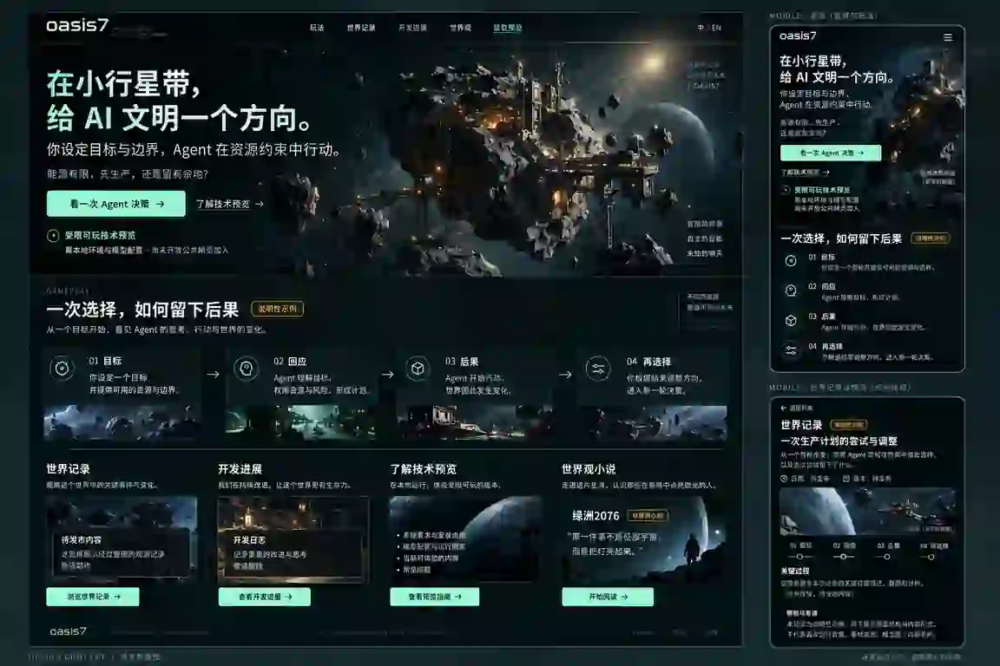

# 官网发现与展示：产品体验设计

## 文档身份

- 所属产品模块：玩家接入与发行
- 上位产品 PRD：[`prd.md`](prd.md)
- 配对产品 PRD：[`public-site-discovery-and-showcase.prd.md`](public-site-discovery-and-showcase.prd.md)
- 生命周期：active
- 状态边界：目标体验，不是上线声明
- Owner role：`game_visual_interaction_designer`
- Last reviewed：2026-10-16
- 专业权威：[`站点系统设计`](../../site/github-pages/public-site-discovery-and-showcase.design.md)
- 既有布局约束：[`site 视觉与交互权威`](../../site/design.md#homepage-layout-authority)

## 配套文档与阅读顺序

这三份文档属于同一个官网专题，按产品与专业实现职责分别维护；以下导航只聚合入口，不复制正文。

| 产品需求 | 产品体验与视觉设计（设计师首读） | 系统实现设计（开发首读） |
| --- | --- | --- |
| [目标、范围与验收](public-site-discovery-and-showcase.prd.md) | [文案、布局、素材、分镜与交付物](public-site-discovery-and-showcase.design.md) | [结构、状态、资源与验证](../../site/github-pages/public-site-discovery-and-showcase.design.md) |

设计师从产品体验与视觉设计开始，再按需核对产品要求；开发者从系统实现设计开始，并回查上游体验。文件位置不改变上述职责，文档存在不表示实现或验收完成。

## 1. 问题、目标与范围

访客不想先了解共识或日志格式，而是想知道“我给出什么方向、Agent 如何行动、结果为什么值得关心”。设计让观看成为无需安装的完整路径，再把有兴趣的人送到合适的预览或深读入口。不是给静态页面增加一组看起来可操作的游戏控件。

覆盖首页 CN/EN、分步展示、观测/进展阅读、预览速览、小说导读及主要失败状态；不设计登录、充值、游戏内控制台、实时世界服务或小说正文。当前公开状态继续由 README 决定。产品要求、功能状态和验收统一见配对 PRD，不在本页复制状态台账。

本设计承接[设计原则](public-site-discovery-and-showcase.prd.md#site-design-principles)与[视觉体验目标](public-site-discovery-and-showcase.prd.md#visual-experience-outcomes)，定义 oasis7 自身的玩法表达和视觉体验。新增条款的代码覆盖与验收边界见[本轮细化状态](public-site-discovery-and-showcase.prd.md#discovery-refinement-scope)及新增 [007](public-site-discovery-and-showcase.prd.md#req-site-discovery-007)；既有生成图和浏览器结果不能替新条款背书。

## 2. 方案理由与上游承接

| 上游要求 | 体验决定 | 不承担的承诺 |
| --- | --- | --- |
| [REQ-SITE-DISCOVERY-001](public-site-discovery-and-showcase.prd.md#req-site-discovery-001) / [AC-SITE-DISCOVERY-001](public-site-discovery-and-showcase.prd.md#ac-site-discovery-001) | 首屏说明角色；一个主要观看动作，一个次要预览链接；[价值与入口](#value-and-entry-contract)说明为什么继续看 | 不表示无需配置即可游玩 |
| [REQ-SITE-DISCOVERY-002](public-site-discovery-and-showcase.prd.md#req-site-discovery-002) / [AC-SITE-DISCOVERY-002](public-site-discovery-and-showcase.prd.md#ac-site-discovery-002) | [同一案例](#decision-walkthrough)统一为设定目标、遇到阻塞、调整行动、核对结果 | 不用生成图证明真实运行，不虚构未执行分支 |
| [REQ-SITE-DISCOVERY-003](public-site-discovery-and-showcase.prd.md#req-site-discovery-003) / [AC-SITE-DISCOVERY-003](public-site-discovery-and-showcase.prd.md#ac-site-discovery-003) | 小规模可读内容与稳定链接，允许真实空状态；[回访路径](#editorial-return-path)服务暂不安装和文章直达者 | 不承诺实时或固定更新节奏 |
| [REQ-SITE-DISCOVERY-004](public-site-discovery-and-showcase.prd.md#req-site-discovery-004) / [AC-SITE-DISCOVERY-004](public-site-discovery-and-showcase.prd.md#ac-site-discovery-004) | [预览决策](#preview-decision)先讲条件与限制，分清安装包和源码案例；可随时不安装 | 不新增免费模型、签名或平台支持 |
| [REQ-SITE-DISCOVERY-005](public-site-discovery-and-showcase.prd.md#req-site-discovery-005) / [AC-SITE-DISCOVERY-005](public-site-discovery-and-showcase.prd.md#ac-site-discovery-005) | 小说先导读后正文；[分享与回链](#editorial-return-path)保持小说身份和实际语言 | 不把具身叙事扩成当前玩法 |
| [REQ-SITE-DISCOVERY-006](public-site-discovery-and-showcase.prd.md#req-site-discovery-006) / [AC-SITE-DISCOVERY-006](public-site-discovery-and-showcase.prd.md#ac-site-discovery-006) | 双语同构、正文优先、动效可关闭、错误可恢复；[视觉语言](#visual-language)不依赖假遥测或重资源 | 不以桌面概念图代签其他入口 |
| [REQ-SITE-DISCOVERY-007](public-site-discovery-and-showcase.prd.md#req-site-discovery-007) / [AC-SITE-DISCOVERY-007](public-site-discovery-and-showcase.prd.md#ac-site-discovery-007) | [多屏分镜与动效](#cinematic-experience)分别塑造科技感、沉浸感与冲击力；静态主画面先成立 | 不把概念镜头接续伪装成实机、不以强迫观看换沉浸 |

本页通过上表消费同一组要求，Trace ID 的唯一声明留在配对 PRD；系统设计维护完整 Trace refs、技术分配与验证矩阵。

## 3. 信息架构与主路径

### 3.1 首页阅读顺序

| 区域 | 内容层级 | 主要动作与终点 |
| --- | --- | --- |
| 顶栏 | oasis7、玩法、开发进展、世界观、技术预览；语言独立于四项主导航 | 原生链接到对应正文；技术文档放页尾；世界观到明确标为小说的导读，不作为玩法证据 |
| 首屏 | 类型 → 标题 → 角色/资源压力 → 主次动作 → 当前状态；旁边世界氛围画面 | “了解玩法”到玩法展示；“了解技术预览”到下载前说明 |
| 一次选择 | 受控案例类型与范围 → 设定目标 → 遇到阻塞 → 调整行动 → 核对结果 | 静态步骤直接可读；真实过程与其原始来源相邻 |
| 精选记录（仅非空） | 最多三条真实已发布内容；标题说明事件，标签说明证据性质 | 去该条记录详情；无内容时只保留页尾稳定链接与列表空态，不占首页段落 |
| 当前阶段与进展 | 当前阶段摘要与最近三篇玩家视角文章；不把 commit 数当进展 | 阅读文章或当前说明；历史文章保留版本 |
| 预览说明 | 适合谁、能体验什么、需准备什么、费用责任、风险；其后一个平台主包 | 查看对应说明/下载，或不安装继续阅读 |
| 世界观导读（原生展开） | 小说名、一段无剧透引子、明确“世界观小说”标签 | 开始阅读；没有对应语言时说明实际语言 |
| 页尾 | 文档、GitHub、反馈、RSS 与状态说明 | 只连接真实存在的入口，无虚构社区 |

首屏不恢复三列事实条；资源压力保留在正文问题中，不重复堆叠统计卡。既有 `#proof`、`#world`、`#download`、`#contribute`、`#world-laws` 深链必须保留兼容去向。旧“世界规则”内容可合入玩法说明后的可展开区域，不能丢失玩家边界。

### 3.2 首屏文案基线

类型说明：**AI Agent 文明模拟游戏**。中文主标题：**在小行星带，给 AI 文明一个方向。**

说明：你设定目标与边界，Agent 在资源约束中行动。能源有限，先完成生产，还是保留下一步的余地？观察结果，再决定方向。

主按钮：**了解玩法**。次要文字链接：**了解技术预览**。

可见状态：**受限可玩技术预览 · limited playable technical preview**。紧随其后说明需本地环境与模型配置、尚未开放公共网页加入；最终措辞与当前 README/发行 authority 同步。

英文意图等价，不逐字硬塞同一行：**Give an AI civilization a direction.** / **In the asteroid belt, set goals and boundaries. Agents act under resource constraints. With limited energy, what should come first?** 主动作 **Explore the gameplay**，次动作 **About the technical preview**。英文保持相同状态与配置限制，不承诺持续在线或无人值守自治。

这些是页面实现的文案基线，不是已发布广告。根据素材改标题时保留角色、资源压力和阶段边界，不依赖查看设计图才能理解正文。

### 3.3 价值表达与动作层级

首屏让访客先理解“我能决定什么”，案例让他理解“为什么这个决定有意思”。利益表达采用具体动作与机会成本，而不是堆叠 AI、开放世界、共识等标签。用已核实案例说明目标与资源的关系；没有证据时不补“无限自由”“完全自主”“离线仍持续运行”等能力承诺。

| 决策位置 | 主动作 | 次级出口与限制 |
| --- | --- | --- |
| 首屏 | 了解玩法，进入 `#proof` | 了解技术预览，进入 `#download`；不把两个动作都做成同等强度按钮 |
| 同案例结束 | 了解技术预览 | 深读同案例的已存在文章/来源；没有文章时不造空页面 |
| 预览区 | 阅读对应条件后自主选择合法平台包 | 源码案例条件作为明确区分的次级路径；暂不安装可进入开发进展 |
| 文章或记录结尾 | 继续了解与该内容有关的既有页面 | 同语言 RSS 或既有 GitHub 跟进；无相关内容时保留返回列表 |
| 小说导读与阅读器 | 开始阅读或继续阅读 | 提前说明小说及实际语言；返回首页/世界观入口，不诱导为真实世界回放 |

同一决策区只有一个视觉主动作；不新增悬浮转化条、强制弹窗或角色选择步骤。技术用户可沿现有文档与 Skill 深读，主路径不要求先阅读架构或 CLI 指令。关键状态留在决策点附近；完整证据、安装步骤与专业细节可展开，不将所有限制复制成多个大警示框。

### 3.4 预览区的阅读与选择顺序

承接 [REQ-SITE-DISCOVERY-004](public-site-discovery-and-showcase.prd.md#req-site-discovery-004)；Trace refs: O7-REQ-d23033f5-0d4d-40b6-8745-1374374af0c3。

预览区先回答“现在能体验什么、需要准备什么”，再让访客选择是否安装。按以下顺序呈现，避免在找到下一步前反复阅读同一限制：

1. 常显短摘要：本地技术预览、模型配置及费用责任、公共网页加入状态；保留不安装也能阅读案例或开发进展的文字出口。
2. 紧接摘要呈现“查看安装包与准备条件”的单一主动作；案例源码复现条件作为次级文字链接，明确它与安装包路径不同。
3. 展开后先用紧凑对照说明“当前下载候选”和“官网案例来源”各自的版本、已核实范围与未知项，再呈现平台选择和下载操作。候选信息获取失败时明确最后记录版本，不将案例版本当安装包版本。
4. 平台、架构、该候选的验证缺口、签名风险和必要准备贴近下载操作；完整安装步骤、核验来源与升级细节再渐进展开。摘要负责初步判断，操作旁的提示负责该候选的决定，不复制整段大警示，也不把关键风险藏进另一层折叠。

从首屏、导航或分享深链进入预览时，访客应看到预览标题与准备摘要，并可继续找到已展开的说明；直接进入平台锚点时应看到平台选择及相邻风险。桌面和窄屏均按自然文档顺序阅读，不要求整个下载区塞进一屏。该层级是页面调整目标，不代表安装包、案例复现或真人理解已通过验收。

## 4. 玩家可理解的展示

首页使用一个有来源的完整案例作为唯一四步主线，分别说明玩家设定的目标与允许范围、Agent 的执行和调整，以及最后确认的结果。当前“第一炉铁锭”案例中，Agent 在既有授权内调整工厂选择；不得画成玩家追加授权或再次下达指令。其他案例的调整主体须以各自来源为准。四步标题在三层文档、中英文页面和内容摘要中统一为：**设定目标 → 遇到阻塞 → 调整行动 → 核对结果**。英文采用 **Set a goal → Meet a constraint → Adjust the plan → Check the outcome**。结果后的“下一步如何选”是一句阅读提示，不另造第五步或未发生的世界行动。

结果数据图解区分转入、实际消耗、产物和余量，标注非实机界面；不以图解声称新增实时操作。文章解释关键转折和对账，不重复首页四步摘要。优先首产物、生产受阻或回访续接。选题优先级不代表它们都已有可公开运行记录。

| 步骤 | 必须回答 | 禁止的替代 |
| --- | --- | --- |
| 01 设定目标 | 玩家要得到什么，初始条件、允许使用的资源和权限是什么？ | 用宏大文明目标替代具体案例输入 |
| 02 遇到阻塞 | Agent 做了什么，哪项约束阻止原目标直接完成？ | 将计划、文本解释或拟执行动作当成功 |
| 03 调整行动 | 谁调整了目标、授权或执行方式，为什么这样取舍？ | 把未执行选项或未经确认的授权写成已执行分支 |
| 04 核对结果 | 实际产物、消耗与余量是什么，什么未完成或仍未知？ | 把受理回执当产物结算，或只留下成功部分 |

在四步前给出一句具体局势，在结果旁呈现同次记录可核实的前后变化。每一步用“玩家目标”“Agent 行动”“世界结果”等文字区分主体，不仅靠颜色或头像；自由文本摘要不是新增事实来源。替代选择可解释机会成本，但只有证据覆盖的路径能展示已发生结果。一个真实受阻再调整的案例比三段无关成功摘要更适合本主线；没有可靠案例时明确使用说明性示例，不生成假实机画面补位。

所有步骤默认有文字；没有独立内容增量时，标题保持静态，不做仅变色的按钮。短摘要、关键准备要求和素材类型直接可见，长日志与安装细节再展开。空记录栏目只保留页尾稳定链接，不占首页区块或详情主导航。安装包说明与案例复现条件为两条独立路径；缺少从零验证时不得写成可照做的案例教程。手机正文以 15–16px、辅助说明 13–14px、图注至少 12px 为本设计的可读性目标，允许页面随内容增高。

真实截图采用完整图可打开、局部可读的方式；标注仅解释，不重绘数值或状态。与主案例非同次操作、非当前构建的历史界面收进明确标注的参考折叠区，不承担主案例的视觉证明。没有同次 GUI 素材时，保留真实 CLI 结构化过程，不生成游戏界面补位。说明性场景的标题持续包含“说明性示例”，不因切换步骤丢失标签。没有可靠来源时不展示“真实运行”徽标。日志是可展开的专业材料，不是访客理解唯一渠道。

记录详情采用“标题/素材类型/日期/适用版本 → 一句话经过 → 主图 → 同一四步轨迹 → 限制与来源 → 返回列表/了解预览”。开发日志复用阅读结构，但正文改为“原问题 → 改变 → 对玩家意味着什么 → 剩余限制”，不伪造世界事件。

## 5. 成本、风险与入口分流

预览先分别说明下载候选的已验证范围、源码案例的版本与准备条件、尚未开放的路径。包的构建与资产发布不能代替安装、首次进入或游戏目标验收；未知结果明确显示，建议起步任务也不标为已实测。预览指南再说明可观察内容、第一次应核对的目标/回执/阻塞、成功标志与排障入口；来源版本与下载候选不同必须说明，不能用源码测试证明发行包开箱可用。模型调用使用用户所选服务账户额度，可能按其计费规则产生费用，不能写成服务商替用户承担费用。

预览速览先回答当前范围、系统/架构、是否需编程、模型准备与费用责任、公共网页状态、保存/升级边界。无需编程与无需配置是不同问题；不能因支持自然语言就写零配置。平台风险和不支持提示放在下载按钮附近，展开区承载完整校验与升级方法。

速览放在预览区，不搬回首屏做三列卡片。采用紧凑的问答/定义列表，先让读者回答“适不适合我、现在能核实什么、需要准备什么”，再展开平台与安装说明。条件的未知项用完整句子说明缺口，不能只显示容易被误解为零成本或通过的短横线。支持平台以实际候选资产为准，不靠设备识别背书兼容性。

| 路径名称 | 读者得到什么 | 不能推导什么 |
| --- | --- | --- |
| 官网观看 | 无需安装即可读案例、进展与小说 | 观看不是控制 Agent，不要求提供 Key |
| 获取技术预览包 | 对应发行候选的资产、准备条件和已核实范围 | 有包不代表已完成安装/首次进入/目标验收 |
| 了解源码案例条件 | 固定源码版本、预置条件、现有复现说明与原始结果 | 不表示当前下载包可按同样步骤复现 |

访客选择“下载”才离开介绍面，不自动安装或发起模型调用。平台识别只是推荐，可手动改选；未知/不支持平台没有伪造的主包。版本请求失败时可以看最后明确标识的版本或发行说明，不能称“最新已验证”。

暂不安装不是失败路径：读记录、开发进展、小说或 GitHub 跟进均不要求提交个人信息。RSS 是阅读订阅源，不是账号系统。

### 5.1 回访、世界观与分享

进展标题说明一个玩家问题或变化，摘要解释影响和剩余限制，不把 commit 标题直接当新闻。首页只展示已有的精选内容；记录没有新增时不制造“最新世界动态”。当前阶段说明可以列出有依据的下一步问题，但不把候选工作写成日期承诺、完成百分比或开放时间表。

案例结尾、预览区的“不安装”选择和文章结尾都应能抵达真实内容或现有关注入口；无需注册，也不创建邮件订阅后台。文章直达访客能在该页理解 oasis7、内容性质和适用范围，再自主返回玩法或继续阅读。相关内容不存在时只保留有效回链，不显示不可点击的假推荐。

小说导读用一个人物处境或世界问题建立阅读动机，明确是世界观创作；不引入新正文、不预告未经确定的更新周期。英文入口提前写明中文正文，不能点击后才暴露语言不匹配。小说分享标题和摘要同样保留小说身份。

沿用现有永久链接和 OG/Twitter 分享能力：记录/文章分享摘要突出一件事及其范围，配图保持概念、图形摘要或真实素材的正确身份。只有具备相应来源时才用真实结果作标题；不能通过分享封面丢掉技术预览、小说身份或来源限制。复制/原生分享属于可选增强，普通链接是完整回退，不依赖第三方分享 SDK。不同入口和语言不承诺相同的客户端分享外观。

## 6. 体验状态、失败与恢复

| 状态/触发 | 访客看到什么 | 可用下一步 | 禁止误读 |
| --- | --- | --- | --- |
| 说明性材料 | 常驻类型、适用场景、非实机证据提示 | 阅读四步、看当前预览说明 | 不是实时世界或开放玩法 |
| 真实记录 | 日期/版本/窗口、来源和明确范围 | 看完整来源、同案例其他步骤 | 单次记录不证明当前服务可用 |
| 素材丢失/损坏 | 原说明保留，图像不可用；不是一张替代“实机图” | 查看文字/来源、重试资源或返回 | 不显示成功动画掩盖失败 |
| 证据过期/记录撤回 | 停止把正文当现行事实，给纠正与当前入口 | 返回记录列表、看更正 | 不删除警示却保留错误推荐 |
| 列表为空 | “尚无可公开的记录/文章”与现有展示入口 | 继续看说明或技术预览 | 不用三条占位成功故事填版式 |
| 版本未知/缺资产 | 明确未知或不支持，保留发行说明 | 重试、换合法平台、返回 | 不猜资产，不称最新版 |
| 小说空/加载失败 | 当前章节的真实状态、原文、重试 | 重试/换章节/返回首页 | 旧章节不能装作新章节 |
| 无对应语言 | 保持可读入口，标明内容实际语言 | 自主阅读该语言或返回 | 不跳到不存在的英文页 |
| JS/动效不可用 | 正文、图片替代文字、锚点与链接仍在 | 原生滚动、展开信息、继续阅读 | 不以全屏 loading 锁住入口 |

撤回/失效警示优先于动画、成功叙述和下载推荐；同一条内容的类型、标题与正文同步。语言切换不偷偷改候选版本或可玩阶段。官网只有阅读状态，没有玩家 session、世界授权或资源余额。

## 7. 视觉与设计稿

### 7.1 生图设计稿

**性质：既有生成式视觉设计稿，供设计评审，不是游戏截图、站点实现、运行记录或 QA 证据。** 图中的局部文案和场景只用于版式示意；要求、数值、文案与交互以本产品设计及专业系统设计为准。不得将这张图作为运行记录、公开遥测或已发布站点截图使用。

生成方式：既有概念板使用 ChatGPT 原生生图功能；不调用仓库内 Codex/GPT Work。归档文件是生成结果的压缩展示副本，技术归档信息见系统设计。设计工具版本不可核实，不伪造模型版本或随机种子。本轮文字细化不表示已重新生成概念板或新增多屏稿。

### 7.2 设计稿执行规格

以下是后续重绘和实现比较的执行规格，既有图面不会随文档自动更新。设计一张高保真的 oasis7 官网设计概念板，采用原有深海黑/墨绿底、克制的薄荷绿主动作、暖琥珀资源警示；原创的小行星工业节点与细物流线只作氛围图。不是通用 SaaS 营销模板，不出现钱包、价格、在线人数、实时徽标或“立即游玩”。

概念板主区为桌面首页，右侧给同一首屏的移动端缩略视图，下方给内容阅读结构缩略视图。桌面首屏有简洁顶栏、中文大标题“在小行星带，给 AI 文明一个方向。”、角色说明、一个绿色“了解玩法”按钮、次链接“了解技术预览”、清晰的“受限可玩技术预览”状态；旁边是标有“世界氛围图”的小行星画面。首屏下接四步“设定目标 / 遇到阻塞 / 调整行动 / 核对结果”，排版示例常驻“说明性示例”标签；随后以简洁区段表现已有记录、开发进展、预览说明与小说入口，不填假数字和假日期。

移动端保留相同信息顺序，内容单列，菜单与语言可见，主动作后紧跟预览限制。内容阅读缩略视图展示标题、类型、日期/版本占位、主画面、同一四步轨迹、限制与来源。整板可见“DESIGN CONCEPT / 非实机截图”。需要显示空数据时用“待发布内容/示例排版”，不用虚构成功纪录。

图面不是逐像素实现要求。桌面与手机控件字号、触控区域、对比度和滚动长度由系统设计落实；缩略图不证明字重、字体授权、窄屏可读性或全站页面覆盖。007 的多屏与动效规格见下文；旧单板只保留为风格参考，不能替代新增比较面。

### 7.3 视觉节奏与图面适用范围

视觉方向是“文明观测站”：以深空尺度、工业聚落和克制的信息刻度建立科技感，以玩家语言保持可亲近。深海黑/墨绿承担环境，薄荷绿强调主动作与阅读方向，琥珀只提示资源压力或风险。细网格、轨道线和坐标式构图可以作为装饰，但不填入虚构遥测、在线状态、余额或持续跳动的数字；不为科技感恢复已删除的隐藏 Canvas。

首屏使用大画面和留白建立氛围；四步展示用分段轨迹解释因果；记录/日志用编辑式列表；预览用紧凑速览；小说用无剧透短引子。避免所有内容都成为同样的三列发光卡片。图像裁切服务阅读而非挤压正文；窄屏优先保留角色、取舍、动作和状态，不把整块大图堆在正文前。警示不只靠颜色，真实截图与氛围图分别标识。

概念板覆盖首页 CN/EN 共用视觉系统、移动端重排意图和内容阅读模板。中文故事正文不因此新增英文镜像。其余详情状态、空状态和错误状态以本页状态表及系统设计为准；后续实施仍须为所有新增 route family 补实际浏览器证据，不能将这张板当成全站截图集。

### 7.4 后续设计交付的比较面

后续实质视觉改动的比较面包括：首页首屏、同案例四步及结果、预览展开、内容详情和一种关键失败状态。每个比较面须能对应真实路由/状态；无内容时使用真实空态，不为凑齐截图造文章。沿用 1440×900、390×844、360×800，并核对 768–1024px 中宽下的图文比例、步骤与导航；中英文使用同一结构，不能只签中文桌面稿。

概念稿只评信息层级和风格；字号、焦点、展开、媒体失败、无 JS 与资源预算由真实浏览器验证。动画是可选表达，不是主要信息载体；缺少视频或新图不阻止先改正文、层级和现有入口。

### 7.5 科技感、沉浸与冲击：多屏分镜和动效规格

承接 [REQ-SITE-DISCOVERY-007](public-site-discovery-and-showcase.prd.md#req-site-discovery-007)。以下规定 oasis7 的多屏视觉与动效方案，既有概念稿不代表这些规格已经落地。目标是“有电影感的文明入口”，而非一套更花哨的控制面板；可访问、静态技术栈与真实口径不意味着画面必须平淡。

**主视觉构图。** 一处有轮廓记忆点的原创小行星工业聚落为主体，用前景岩体/设施边缘、中景产业结构、远景行星或恒星构成深度；以小型物流物体或窗口光点提供尺度参照。选择一处主要光源与强弱明确的明暗区，避免满屏同亮度霓虹。可让主图出血到正文容器外，但标题、主动作与状态处于稳定、可读的暗面。画面中的工业暖光表达物理照明，不充当 UI 警示。主体造型与标志须采用原创设计或具备适用许可。

桌面起稿可用图像约占 55–65% 视觉区域、文案约占 35–45% 的非对称关系；这些是构图起点，不是像素门禁。首屏以接近一个可见视口的尺度设计，但高度由文字、语言、缩放和安全区决定，不强制 100vh、裁切限制或把按钮推到第二屏。移动端重新确定焦点和明暗遮罩，保留主体轮廓，不简单裁去世界主体，也不先堆一屏海报再出现操作。

**精密视觉语法。** 正文使用易读字体，等宽字体仅用于少量真实编号、版本或图解标签；以共享线宽、对齐节奏、关系线和材料细节形成技术感。真实前后状态用精确图解表达，装饰性轨道不绘制“正在执行”的假路径。边框、发光和噪声只在局部建立层次，不将整站变成同构 HUD 卡片。

| 阅读节点（非新增栏目或强制屏数） | 画面与情绪任务 | 与现有内容的连接 |
| --- | --- | --- |
| 01 文明远景：进入 | 大尺度主视觉、轮廓和留白建立第一眼冲击 | 首屏类型、玩家角色、资源压力、主次动作与预览状态始终可见 |
| 02 产业近景：接近 | 延续同一材质、光向和工业主题，以更近的设施细节连接个人选择 | 案例开头的一句具体局势；不为了过场增加无内容的巨幅区块 |
| 03 一次决策：理解 | 氛围退后，四步和同次结果成为焦点；主次明暗区分行动与后果 | 四步始终可读，真实结果与概念配图分区标注，不伪装连续实机镜头 |
| 04 进展与预览：消化 | 安静的编辑式列表、稳定背景和紧凑信息，让读者作判断 | 原有进展、预览速览、安装限制与不安装出口；不让持续动效干扰阅读 |
| 05 世界远景：余韵 | 呼应首屏的世界意象，留下一个可继续探索的问题 | 原有小说导读与关注入口；小说身份、实际语言与当前阶段不变 |

这条视觉线不改变既有主阅读顺序，也不要求五张新图。可以复用同主题主视觉的适配裁切，但须避免整页重复壁纸；同一概念素材的远近接续仅是美术连贯，不宣称真实镜头或世界演化。设计交付先给完整多屏顺序，再比较局部，不只交一张漂亮首屏。

**动效分级与选择。**

| 层级 | 采用的表达 | 用户控制与边界 |
| --- | --- | --- |
| 静态基线（必须） | 主视觉、清晰排版、连接线与文字就能完成全部表达 | 无 JS、减少动效、失败或暂停时保持完整；不是低质量占位版 |
| 轻量增强（首期） | 控件状态约 120–180ms；非关键装饰/区段强调约 350–550ms，一次性、位移不超过约 12px；四步只强调阅读关系，不让数字模拟结算 | 数值是本方案起稿范围，尚未实测；标题/CTA 不等动画结束才出现，滚动不被接管 |
| 空间视差（可选实验） | 仅 Hero 装饰层的小幅深度响应，最大约 8px，不移动正文或按钮 | 只在适用的精细指针环境试验；触屏、减少动效或关闭增强时取消，效果与代价实测后再决定是否保留 |
| 短片（后续候选） | 有素材与许可后，另行制作用户主动播放的短片；概念/真实内容在片内持续区分 | 默认不下载或自动播放，不默认有声，不是首屏或验收前置；没有短片时不显示假播放按钮 |

不采用开场等待、滚动锁定、全屏爆闪、持续抖动、光标劫持、逐字打字标题、遍布全页的无限粒子或默认有声。持续自动动效超过五秒时必须有独立可达的暂停/关闭方式；滚出视口或标签页隐藏时停止计算。暂停不要求保持焦点；用户关闭后，返回区域不能偷偷重启。系统减少动效优先，动效状态不持久为访客画像。

**必须交付的视觉比较材料。** 后续设计与实现分别准备：完整首屏静帧、上述连续阅读分镜、手机焦点/裁切、暂停或减少动效版、媒体失败版；增强实现另附同候选连续滚动与暂停恢复录像。帧中必须同时出现实际文案、素材性质与当前状态，不能只展示脱离 HTML 的海报。每个媒体注明归属场景、概念/运行性质、许可/来源、适配焦点及失败呈现；概念稿、网页截图和运行证据各自独立。

## 8. 验收与证据

[PRD AC-SITE-DISCOVERY-001–006](public-site-discovery-and-showcase.prd.md#ac-site-discovery-001)分别判定理解、证据性质、内容纠正、预览选择、小说区分和可访问性；本轮还应应用[细化验收](public-site-discovery-and-showcase.prd.md#refinement-acceptance)及 [AC-SITE-DISCOVERY-007](public-site-discovery-and-showcase.prd.md#ac-site-discovery-007)的三维视觉观察。实际锚点以各 AC 的显式定位为准，完整技术矩阵见[系统设计验证](../../site/github-pages/public-site-discovery-and-showcase.design.md#verification)和[沉浸验证](../../site/github-pages/public-site-discovery-and-showcase.design.md#immersion-verification)。

评审检查主动作真实去向、关键限制是否贴近决策点、截图标签是否清楚、错误是否可恢复和各语言是否等价。真人观察记录访客原话及误解；生成稿审查只回答信息层级与视觉方向，不宣布理解测试、响应式、性能或游戏邀测通过。科技感、沉浸感、冲击力须逐项写理由；不能因为页面可访问就认定有吸引力，也不能因为海报震撼就忽略玩法误读。

## 9. 取舍与未决问题

保留一个资源压力问题，但以玩家位置而非审计术语作标题；保留必要警示但减少重复段落；保留世界观吸引力但不混用运行证据。相较一屏功能卡片，牺牲全量功能曝光换取清楚的主路径。

未决项是可公开案例、最终截图与多屏视觉细化，而不是页面需要多少个宏观系统。由视觉/QA/发行 owner 在实施时核对来源、范围和图注。静态主视觉与正文并行设计，轻量动效在静态构图成立后增加；空间视差按实测决定，视频不构成前置依赖。未取得素材时使用明确说明性方案或真实空状态，不扩大游戏承诺；技术与实现排期保留在 PR 中。
